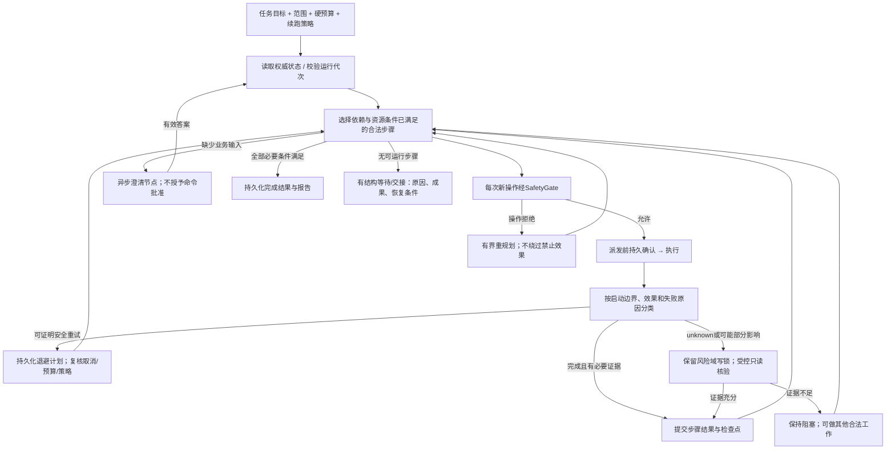

# 模式3自主完成任务：运行连续性设计研究

> 后续讨论已合并至[安全与自主执行统一设计](AGENT_SAFETY_AND_AUTONOMY_DESIGN.md)，包括审核/诊断职责、软纠正与硬熔断。本文保留连续性研究和历史验证，后续开发目标以统一文档为入口。

> 基准：CloudHelm 0.2.4，分支 `repair/comprehensive-audit`，HEAD `a50fae2`。
> 输入：用户本轮提供的长任务连续性设计，以及已明确的模式3交互要求：**命令由工具决定，不向用户申请批准；业务方向和必要细节可以澄清。**
> 本轮研究源码、运行本地定向回归并新增报告；不修改业务代码，不连接真实SSH，不调用付费模型。上一篇报告：[安全系统比较研究](SECURITY_SYSTEM_COMPARATIVE_REVIEW.md)。

## 一、结论

**采纳这份文档的主方向：从“以一轮模型回答为中心”演进到“以任务结果为中心”，让可恢复障碍在后台被处理，而不是每次要求用户点继续。**

但不能照搬“每个非终态都有自动出路”“known-failed可以重试三次”“unknown核验不了就当失败”“非关键问题默认继续”等绝对表述。

推荐的准确目标是：

> **在用户给定的目标、权限、成本和时间边界内，Agent持续推进所有当前可安全执行的工作；暂时障碍自动恢复，未知变更先核验。确实无法推进时持久保存交接点，明确原因和恢复条件，而不是无说明地停止。**

“自主完成”不是保证任何任务都能完成，也不是保证进程永不崩溃。它包含三项可工程化的保证：

1. **不会因可恢复的单操作失败无条件终止整项任务。**
2. **停止运行不等于丢失进度；恢复不等于重放已派发变更。**
3. **所有可观察的停点有明确状态、原因、已完成工作和接续条件；突然崩溃后的交接包由持久事实补建。**

## 二、当前项目到底具备什么

### 2.1 不是完全没有自主循环、重试、压缩和恢复

| 能力 | 当前源码行为 | 与目标的距离 |
| --- | --- | --- |
| 多轮工具循环 | 使用Pi原生会话，工具结果后可以继续推理 | 已有，不必另造Agent循环 |
| 安全HTTP重试 | 固定JSON请求，对受限瞬时错误最多三次尝试，每次预留预算 | 已有；不能扩为整轮prompt或远端命令重放 |
| 上下文压缩 | 原生语义压缩已开启，保留完整JSONL；压缩请求计预算 | 已有；不是需要从零做一个75%阈值 |
| 上下文容量 | 按输入帧、历史、输出预留及安全余量估算 | 已有；压缩失败/巨大单条结果仍可能阻塞 |
| 未知结果写锁 | 同主机/关联风险域内禁止新变更，允许已证明无变更的查询 | 安全底座已有，但TaskRunner常把整轮先暂停 |
| 恢复登记 | 有引用较新同主机只读证据的 `record_reconciled_result` | 已有；不能直接当作确定性的自动核验器 |
| 持久恢复 | SQLite存任务/操作/报告，Pi JSONL存模型会话 | 已有；恢复默认不请求模型、不连接SSH、不重放 |
| 计划 | 有可见步骤和状态，可保存到任务 | 是模型进度投影，不是依赖/资源调度图 |
| 澄清 | 与审批分离，代次/期限/重复/迟到答案受控 | 当前等待阻塞本会话，取消/过期暂停，不是异步任务节点 |
| 运行进程隔离 | Agent/SSH在utility process，Main负责状态与IPC | UI不是Agent线程，但仍不是独立常驻后台服务 |

主要依据：

- `packages/adapters/src/pi-session.ts:34–73,245–289,391–430`；
- `packages/adapters/src/model-request-retry.ts:65–123`；
- `packages/core/src/context-budget.ts`；
- `packages/adapters/src/pi-session-storage.ts`；
- `packages/application/src/host-serial-executor.ts`；
- `packages/contracts/src/index.ts:50–52,98`。

### 2.2 用户感到“中断”的一些具体路径确实来自当前协调策略

| 触发点 | 当前行为 | 对模式3的建议 |
| --- | --- | --- |
| 远端结果unknown | `blockRemote` + 暂停整轮 + abort模型 | 转入受限核验阶段，不立即结束整个任务 |
| 失败且effects=possible | 同上 | 保持写锁，核验原作用；不能普通重试 |
| 同类失败达到三次 | 暂停并abort | 按失败边界/是否有进展处理，能改计划则改计划 |
| 连续AI拒绝三次 | 暂停，要求检查或人工处理 | 终止该拒绝分支，继续合法独立工作；没有工作再交接 |
| 命中部分硬拒绝/安全故障 | `reviewCoordination`可暂停整轮 | 保留操作拒绝，区分任务可继续范围；全局安全故障仍禁止派发 |
| 十轮无新观察 | 请求前暂停 | 进入有界重新规划；不靠新措辞/新ID伪造进展 |
| 压缩失败或模型输出截断 | 标记failure，暂停或失败 | 有界恢复；无法恢复则从事实生成交接包 |
| 请求预算耗尽 | 暂停，要求显式追加100次 | 提前预留收尾能力；耗尽后不再偷偷调用模型 |
| 等待澄清 | 全会话等待，混合批次其他工具也被阻止 | 拆出独立澄清节点后才能继续无依赖工作 |
| utility退出 | Main登记未知/恢复状态，提示重开 | 增加受控进程监督与恢复调度，不直接重跑原命令 |

证据：`apps/desktop/src/worker/task-runner.ts:116–122,190–215,227–239,475–529`、`task-progress.ts:9–26`、`review-coordination.ts`、`apps/desktop/src/main/app-state.ts:751–777`。

**这里应修的是“操作结果→任务控制动作”的映射，不是把SafetyGate关掉。** 当前第三档还存在高影响人工审批与不透明放行，需与上一篇报告§3.2的目标一起迁移。

### 2.3 还有一个容易忽视的差距：回答结束不等于任务做完

`decideTaskCompletion` 在没有未决变更时，可根据模型有完整回答返回 `answered`；`lastTurnAnswered` 主要表示原生回复正常结束且有非空正文。源码已经明确这不代表业务目标全部完成。

这对聊天是合理的，对“30步任务自主做完”不够。需要区分：

- `turn_settled`：一次模型循环结束；
- `task_completed`：约定的任务步骤与完成条件已经满足；
- `task_blocked/partial`：仍有无法推进的必要步骤，需要交接。

不能把一段“接下来可以……”的回答当任务成功，也不能为追求完成率让后台无限追问模型。任务完成条件需绑定用户目标及证据；模型解释与后端事实继续分层，不宣称任意业务目标都能被机械证明。

证据：`apps/desktop/src/worker/task-completion.ts:27–43`、`packages/adapters/src/pi-session.ts:255–261`。

## 三、这份设计需要修正的九个关键点

### 3.1 known-failed不是“可以重试”，网络超时也不是“瞬时且无影响”

`exitCode != 0`只能说明退出结果，不能证明没有执行。包安装、迁移、上传、重启、部署都可能先改变状态再失败；同一命令改个参数也不自动安全。

应先分执行边界，再判断失败原因：

| 权威事实 | 后续路径 |
| --- | --- |
| 可证明未派发/业务未启动 | 修正或有界重试；重新过安全门和预算 |
| 只读观察失败 | 可按错误类型、取消和预算决定重试 |
| 已派发，副作用未知/可能部分生效 | 立即锁定风险域，先核验，禁止盲重放 |
| 已确认的部分效果 | 根据已知状态设计新的修复/后续操作，逐项审核；不是重放原命令 |
| 有幂等键、前置版本与后置条件的受控操作 | 由对应适配器声明可重试条件，不能由LLM一句“幂等”决定 |
| 用户主动停止、权限撤销、凭据拒绝、硬禁令 | 不自动重启或包装成另一条重试 |

因此不建议把“网络/超时/资源忙”统一映射到2/4/8秒重试。错误分类只能辅助决策，`execution/effects`必须来自可信传输/执行事实。

### 3.2 unknown核验失败后必须仍然unknown

用户流程图中的“核验不了→当作失败走F分支”需要改写：

> 核验失败只表明没有得到足够证据，不会让原操作变成known-failed，更不能借通用失败分支获得重试资格。

允许有界重试**只读核验**，或者诊断连接和环境；原写锁持续存在。证据长期无法取得则进入 `blocked_unknown`/交接，不自动风险接受、不自动回滚、不重新派发原变更。

### 3.3 当前写锁不是只锁“同一个目标再写一次”

`HostSerialExecutor`的当前保守边界是同主机/关联风险域的**所有新Agent变更**，不是只挡同一条命令或同一路径；绑定停止操作有受控例外。它允许获准的无变更查询，不意味着同主机不相干文件可自动继续写。

因此“锁期间agent该干什么干什么”应改为：继续获准只读核验、已有日志分析、报告整理，以及能够证明不依赖此风险域的工作。当前产品是单主机对话，不能把未来跨主机调度算作已有能力。

未来细化资源锁可以研究，但任意Shell影响范围通常未知；必须由后端证明完整资源集合、读写冲突和依赖，不能由模型声称“不相关”就缩小锁。

### 3.4 自动解锁需要操作专属证据，不是随便查一次状态

`ls -la`只能证明当时某路径的可见状态；`systemctl status`只能观察服务的部分状态。它们不能普遍证明：原进程已经退出、目标内容是本次写入、没有部分影响、以后不会再变更。

当前 `record_reconciled_result` 检查同任务/同主机/较新/成功/只读等证据资格，并由模型提供outcome与解释；它没有通用地证明每条查询正文与原操作的资源/效果对应。串行器会拒绝仍有活跃completion promise的对象，但**没有活跃promise不等于远端进程已被证明退出**。

所以现有接口不能原样接到新流程中当作强自动核验器。建议为高价值受控操作定义：

- 后端登记操作ID、稳定目标、原版本、预期结果和允许核验动作；
- 可信的进程/驱动收据、原进程存活状态、资源身份及内容/元数据版本；
- 核验器返回 `confirmed_applied / confirmed_not_started / confirmed_known_effects / unresolved`；
- 只有证据覆盖该操作和风险范围，才持久登记解决结果并释放相应锁；
- 同一协议内的解决记录与解锁需保持崩溃一致，持久化失败不让后续写入抢先通过。

对于任意Shell，允许结论是 `unresolved`。宁可解释清楚停点，也不能把“目标看起来满足”伪装成“原操作全部效果已知”。

证据：`apps/desktop/src/worker/reconciliation-tool.ts:36–88`、`packages/application/src/host-serial-executor.ts:73–84`。这是自动化前必须补的信任边界，不是本轮已经演示过的真实主机漏洞利用。

### 3.5 “绕路”不得成为绕过安全边界

拒绝反馈可帮助选择**实质更安全、在原目标范围内**的方案，例如把广泛删除改为有界列举后处理；每个新操作仍需安全门判断。

不能通过换工具、换身份、编码、包装脚本、换host配置或拆分步骤完成同一项被禁止的效果。关键路径全被硬禁令挡住时，应报告 `blocked_policy`，而不是问“是否继续/换模式/承担风险”并把它叫任务澄清。

只有业务事实确实缺失才能提问，例如“操作哪个已授权服务？”；用户答案也不成为批准令牌。

### 3.6 “非关键路径”不能推出“可以默认选择”

依赖图只能说明其他工作能否先做，不能决定这个选择的风险。日志保留30天涉及删数据、合规和存储，不能仅因为它不是当前关键路径就替用户决定。

采用默认值还应满足：已有用户偏好或显式默认策略、影响有界且可逆、不改变数据删除/对外暴露/费用/生产目标/权限范围。拿不准就阻塞该节点，继续其他合法节点。

异步澄清必须与暂停/取消区分：用户不回答可以等待；用户取消或停止不能被当作“那就按默认值继续”。迟到答案需验证仍属于当前目标和图版本，只修改未来分支，不事后自动重做已完成工作。

### 3.7 上下文容量、累计预算、运行时长是三种资源

压缩能减少活动上下文，不会返还调用次数、累计token或费用；压缩本身还要付费并消耗预算。不能把达到成本上限处理成“换页继续”。

当前已有原生压缩和容量模型，建议：

- 以实际输入帧+工具schema+预期结果+输出预留+安全余量判断，而不是固定75%；
- 原始历史和经净化的必要证据保留在持久存储，活动上下文压缩；不是把旧文件物理删除；
- 结构化检查点从后端重建：目标、约束、待完成节点、已观察效果、未知锁、预算、版本及证据引用；模型摘要不是授权来源；
- 处理巨大单条结果：分页/有界输出/引用，不假设压缩一定释放空间；
- 提前划出压缩与收尾额度，并计入总硬上限；用尽后以确定性模板产出交接包，不再临时请求LLM写总结。

当前SQLite和JSONL是两类存储，不是“SQLite里已有全部模型事实”。跨存储检查点需要绑定各自游标/修订与提交确认；恢复时以权威操作事实补齐，不靠摘要补造“已执行”结论。

### 3.8 统一错误结果有价值，但不能吞掉所有控制与安全异常

用户示例需要至少补 `isError: true`、公开结构化结果，以及可信的执行边界。`retryable`不能仅由异常名称推导：SSH错误可能发生在写入之后。

建议结果携带：固定原因码、操作/步骤ID、`execution/effects`、阻塞范围、允许的下一步、重试类型与剩余额度、证据引用。普通展示文本不是权限指令；未知异常默认不授予重试权。

- 用户取消、租约/身份/策略失效立即撤销权限，不作为普通网络错误继续；
- 审计/存储失败、协议损坏等可以转为结构化诊断，但执行通道必须失败关闭；
- 安全组件不可用时不能为“不断流”派发未经判定的读取或写入；
- IPC/RPC超时只是调用方未收到回执，不证明worker或远端操作已停止；先查权威运行状态，不按同一请求重新创建任务；
- 编程缺陷可隔离崩溃并由监督器恢复，不能在损坏的运行状态上永久catch-and-continue；
- 不捕获原始秘密/错误正文直接回灌模型；必要诊断使用净化类别和本地关联ID。

Pi SDK能返回工具错误，不代表任务恢复机制已经存在。当前还需要重构TaskRunner的任务级协调策略。

### 3.9 托盘后台、系统休眠、断电和远端常驻不是一件事

当前非macOS关闭最后窗口会触发退出；确认退出后Main关闭RuntimeBridge，后者kill utility process。macOS关闭窗口与退出应用也不是同一动作。单独使用utility process/sidecar不能保证宿主退出后任务继续。

应区分四档承诺：

| 情况 | 可承诺的行为 |
| --- | --- |
| 窗口隐藏/关闭，但应用仍运行且电脑清醒 | 可通过托盘/后台应用继续本地Agent，UI重开恢复投影 |
| 笔记本合盖进入休眠 | 本地Agent不能继续推理/计时/联网；唤醒后恢复并核验SSH原操作 |
| 应用崩溃或被系统杀死 | 监督器/下次启动从最后确认检查点恢复；不能保证死前写出最后报告 |
| 断电或明确退出全部进程 | 本地不继续工作；需要重启恢复，或另行设计常在线远端runner |

防休眠只能在用户与系统策略允许时尽力使用，不能覆盖强制休眠或断电。若产品真的要求“合盖两小时仍然执行新的推理和命令”，需要常在线运行端及新的凭据、网络、授权和同步架构，不能靠本地checkpoint或tmux完成。tmux/服务可保住已启动远端程序，但不会让本地LLM控制循环在休眠中运行。

证据：`apps/desktop/src/main/index.ts:272–287`、`app-shutdown.ts:18–50`、`runtime-bridge.ts:27–34,110–115`。用户的挂机验收应拆成“后台清醒运行”和“休眠后可靠恢复”两项。

## 四、建议的目标运行模型

### 4.1 不必另建第二套万能Agent，增加一个后端连续性协调层

保留原生Pi会话、SafetyGate、HostSerialExecutor、认证通道和现有journal。把TaskRunner中散落的暂停判断逐步收敛为**同一个连续性策略**，不是叠加第二个互相覆盖的状态机。

按现有依赖方向：

- **core**：步骤/检查点/失败事实/重试与续跑租约的纯类型和决策策略；
- **application**：协调模型轮次、合法下一步、核验、依赖/资源等待、预算与持久提交；
- **adapters**：Pi会话压缩与历史、SQLite版本化迁移、受控核验、SSH连接和计时唤醒；
- **desktop Main**：监督utility、凭据、任务续跑权威、生命周期与IPC装配；
- **renderer/preload**：状态、澄清和交接投影，不能发放续跑权或释放写锁。

第一阶段不需要多Agent、不需要并行远端变更，也不需要引入重型工作流平台。先让单主机顺序任务正确恢复，再扩独立节点调度。

### 4.2 业务步骤、运行阶段与快照应拆开

用户提供的状态机把RUNNING、CHECKPOINT、等待、完成放在一个枚举里，容易出现“写检查点时任务是否还运行”的歧义。建议概念上分开，实际字段沿现有契约版本化演进：

- **步骤状态**：`pending / running / blocked / succeeded / failed / skipped`；
- **阻塞原因**：`clarification / unknown_effects / policy / capability / authentication / budget / safety_unavailable`；
- **运行阶段**：`executing / verifying / replanning / waiting_retry / compacting / recovering / idle`；
- **任务结果**：`active / completed / partial / cancelled`；blocked属于可恢复状态，不冒充成功；
- **checkpoint**：带修订的持久快照，不是必须暂停的业务状态。

`failed`步骤不一定结束任务；必需步骤失败且没有合法替代时，任务才能形成partial交接。可选步骤失败不能被隐藏，需记录不影响哪些完成条件。checkpoint不是terminal，partial交接后可在原任务上创建新的运行代次继续。

图中的返回边都受预算、退避和事件触发控制，**无可运行步骤时不能忙轮询或反复问模型同一个问题**。

### 4.3 自动续跑需要一个持续有效、可撤销的任务级租约

这是任务开始时选择模式3所建立的运行契约，不是每条命令再问用户。

租约可绑定：任务/目标修订、主机风险域、策略版本、执行身份、任务截止时间、成本/次数预算、后台及重启续跑政策。每次重试/恢复前核验；不能把过期批准、旧连接代次或旧秘密缓存恢复成新授权。

明确优先级：

1. 用户停止、取消任务、撤权、人工接管优先，不能被监督器自动复活；
2. 宿主崩溃/网络故障按仍有效的模式3续跑契约恢复，不要求用户点一次“继续”；
3. 新指纹、凭据缺失或能力不足不自动忽略，记为明确阻塞；认证不是业务澄清；
4. 后台与恢复不会给任务自动加预算，不换模型计费来源，不扩到其他主机/身份；
5. 监督器只能重建本地控制循环，不能重发未确定的远端变更。

恢复前拿到唯一owner/运行epoch和持久租约，避免旧worker迟到、新worker恢复、定时重试三者并发。重新连接产生新代次，旧回执仅按其原操作身份登记，不能覆盖新操作或授予执行权。

### 4.4 最小checkpoint内容

| 分组 | 应保存的字段/事实 |
| --- | --- |
| 目标与约束 | 目标修订、用户边界、主机风险域、模式、策略版本 |
| 工作图 | 稳定步骤ID、依赖、资源、必需/可选、状态、完成条件、阻塞原因 |
| 操作账 | 对应操作ID、派发阶段、execution/effects、已知进程/收据与证据引用、未知锁 |
| 继续计划 | 下一候选步骤、待核验对象、尝试过的替代、不得重放集合 |
| 调度与预算 | 各层剩余次数/成本/时长、retryAt、retryKind、次数、唯一owner/epoch |
| 会话绑定 | Pi JSONL身份、提交游标/修订、压缩摘要引用，不能仅存摘要正文 |
| 澄清 | 稳定问题/节点ID、图与目标版本、答案状态、有效期；重启发新运行代次的能力 |

保存的是经净化事实和秘密引用，不含密码。已有日志有保留期和容量限制，不能声称所有原始输出永远完整；检查点引用必要证据的保存策略必须独立明确。

跨SQLite和JSONL不必假装存在全局事务，可采用权威SQLite检查点+会话游标+可重建投影。恢复校对不一致窗口，不猜测丢失的工具结果，也不直接重放。当前JSONL恢复严格拒绝损坏记录；以后如支持尾部不完整记录恢复，必须有明确提交边界，不能笼统忽略坏行。

## 五、重试、防循环和异步澄清的具体规则

### 5.1 重试分层，不能互相放大

1. **HTTP尝试**：当前受限重试保留；成功响应交付后的流错误不由fetch层自动重试。
2. **模型轮次恢复**：从已提交工具结果和权威任务事实发起新的受控继续，不重放前一轮prompt；残缺工具调用不执行。
3. **远端操作恢复**：先看execution/effects；只对可证明安全的类型重试，未知变更不进入此分支。
4. **核验查询重试**：单独有观察次数、退避和新信息检测，不能因查询一直失败释放写锁。
5. **进程恢复**：监督器有限重启+冷却，重复崩溃形成交接，避免restart风暴。

所有层共用全任务硬预算，并记录各自预算；不要变成“HTTP三次×模型三次×命令三次×worker三次”。退避带jitter、尊重合理Retry-After；401/403、额度不足、权限与策略拒绝不做普通瞬时重试。

长达15分钟的API等待可以作为配置上限，不是普遍默认保证。等待计划持久化为retryAt，可取消，不占用旧审批或SSH输入能力；醒来前再查任务、成本与策略。模型服务不可用时也能由后端直接展示诊断与检查点。

### 5.2 防循环看“有没有新的事实或有效方案”，不只看相同字符串

- 同一变更结果未知：第一次就禁止重放，不等次数阈值。
- 安全查询重复：可能是正常观察；需要新状态/退避/上限，不一律第三次终止。
- 确定失败且条件没变：不因“还剩三次”就再跑；先找可证明改变的前提。
- 连续拒绝：禁止包装/改名试探同一禁止效果；可推进真正独立的合法步骤。
- 改了参数/工具名：不自动算新方案；新ID和模型新说法不算进展。
- 没有合法新分支：停止浪费预算，形成partial/blocked交接，而不是强迫Agent继续输出。

当前TaskProgress只接受后端观察、10轮无新进展触发保护的方向值得保留；应给保护新增“受控重规划/结构化交接”的出口，而不是删除它。

### 5.3 异步澄清需改变现有工具契约，不能只改提示词

当前 `ClarificationCoordinator.ask()` 返回一个等待答案的Promise；Pi外层工具顺序执行，ask_user与其他操作混合调用被明确阻止。简单延长超时或告诉模型“先干别的”不会实现异步。

建议两阶段引入：

- 先在规划时合并必要澄清、使用已有安全默认、先做获准诊断，减少中途等待；
- 再增加 `questionId/nodeId`式持久问题能力：提出问题立即返回pending，调度器只阻塞依赖该答案的节点；收到答案后按owner/epoch去重唤醒。

没有依赖/资源证据前，不开放“问问题的同时任意执行同一批命令”。保持当前混合调用守卫，直到新契约和测试能够替代它。

## 六、与现有整改任务的实施顺序

| 优先级 | 交付包 | 对应现有项 | 可见改善与底线 |
| --- | --- | --- | --- |
| P0-A | 模式3裁决与协调分离 | A05–A07/B08/H01/H04 | 零命令审批；单项拒绝不必整轮停，安全故障不能放行；不自动降到人工档 |
| P0-B | 核验能力与未知状态延续 | A01/B01–B07/C06/H02/H03 | 写锁不变；具备观察专用阶段和操作证据契约；核验失败不转可重试 |
| P0-C | 结构化checkpoint与无模型交接包 | H01/H04/F05/G01/G02 | 停点原因、已完成/未完成与恢复条件可读；SQLite迁移与JSONL绑定明确 |
| P0-D | 分层重试、成本/时长和停止优先级 | H05/H02/B05/C07 | 可恢复故障自动处理；所有尝试同计；取消不复活、unknown不重放 |
| P1-A | 上下文连续性加固 | H01/H05，新增明确连续性子包 | 复用原生压缩；预留收尾、巨大单条结果处理、摘要不成为授权来源 |
| P1-B | 唯一owner监督恢复与后台窗口生命周期 | H03/H04/C07/F05，新增明确连续性子包 | worker失败可有限恢复；托盘后台/退出/睡眠定义清楚，老worker无派发权 |
| P1-C | 持久步骤图与异步澄清 | A03/H01/F05/U06/U07，新增明确连续性子包 | 只推进无依赖且无资源冲突的节点；业务回答不解除安全禁令 |
| P2 | 常在线远端执行端 | 新架构/单独立项 | 仅当要求合盖后仍持续推理与派发，才增加远端runner与新的信任边界 |

原父项的当前状态不因本报告变成“完成”。连续性能力有些是原整改之外的新产品工作，不能把它们悄悄塞进F03“正文流式”或仅做UI就宣称完成。

推荐最小落地顺序：**先把“暂停整轮”改成“保留边界的恢复/交接”，再做进程自动恢复，最后做异步依赖调度。** 不要同时放松写锁、启用并发、自动重试所有操作和后台续跑，否则无法定位风险来源。

## 七、修订后的验收标准

| 场景 | 必须观察到的结果 |
| --- | --- |
| 普通远端命令确定未派发且瞬时失败 | 有界重试，新的审计和执行前复核；不发审批 |
| 命令执行一半失败 | 保留possible影响，不自动重放；核验/修复或明确交接 |
| 写命令派发后拔线 | 同风险域写锁→受限只读核验→证据充分才恢复；原命令不重复派发 |
| 查询返回目标已存在但原进程仍活着 | 不以目标存在解锁；必要时继续观察或阻塞 |
| 核验证据无关/不足/读取失败 | unknown保留，不改成普通失败，不获得重试资格 |
| 工具/模型HTTP短暂故障 | 后台恢复，同一逻辑请求与每次尝试可追踪，已完成工具不重跑 |
| 工具后模型流中断 | 已确认工具结果保留；残缺工具调用不执行；从控制边界受控继续 |
| 连续拒绝或无进展 | 不绕审、不问“是否执行”；有合法分支则推进，否则交接 |
| 至少30步长任务且压缩一次 | 目标/约束/步骤/未知锁保留；不重复变更；模型摘要不能授权 |
| 压缩故障/预算耗尽/模型离线 | 不强行越限；已有事实生成可读交接，不依赖最后一次模型成功 |
| 澄清长时间无人回答 | 无依赖合法节点继续；高风险选择不默认；无工作时明确等待 |
| 用户取消问题或停止任务 | 停止相关继续权；定时器、重连和worker重启不能自动复活 |
| utility崩溃且Main仍在 | 新owner有限恢复，旧epoch无派发权；未确认操作保持未知 |
| 两次恢复事件同时到达 | 只有一个owner，后端去重，不双派发 |
| 关闭窗口但应用保持清醒后台 | 无运行丢失；重开UI只投影状态，不重建重复任务 |
| 合盖休眠/断电后恢复 | 从已确认检查点重建并核验；不宣称休眠时本地继续运行 |
| 磁盘满/SQLite确认失败 | 禁止新派发，保留最后已确认事实；恢复后提示不完整窗口 |
| 重启时JSONL与SQLite不一致 | 不猜测成功、不重放；校对或明确损坏/待恢复状态 |

物理上无法保证任意崩溃、断电或磁盘损坏前写出最终checkpoint。因此用**最后确认检查点+保守未知窗口+重启后补建交接包**验收，而不是承诺“进程绝不会死、日志永不戛然而止”。

建议监测：可恢复故障自主恢复率、无理由停点数、未知重放数、重复派发数、取消后自动复活数、错误解锁数、检查点落盘延迟、恢复时长、澄清期间合法进展、总费用与层级重试放大倍数。未知变更重放、重复派发、取消后复活与错误解锁的测试目标均为零，不能只追求任务完成率。

## 八、本轮验证与限制

- 已按上述路径核对源码和已有测试；部分当前的“暂停”属于明确保守策略，不把它们统称为实现bug，也不声称同类产品几乎所有中断都非bug。
- 本地定向回归任务 `b31253f5f` 退出码0：10个文件、86项测试全部通过。覆盖 `model-request-retry`（24）、`pi-session-retry`（4）、`pi-compaction`（4）、`host-serial-executor`（11）、`clarification-coordinator`（4）、`task-runner-retry`（1）、`task-runner-clarification`（5）、`reconciliation-tool`（16）、`operation-recovery`（6）、`app-shutdown`（11）。运行方式为 `pnpm exec vitest run` 加对应十个测试路径及 `--maxWorkers=2 --minWorkers=1`。
- 其中原生Pi/本地模型夹具确认：工具之后的HTTP重试不会重复已完成远端动作；压缩保留JSONL；澄清当前会等待并阻止混合工具调用；未决写锁、恢复登记和退出策略符合现有断言。它们验证当前机制，不证明模式3自动续跑、强自动解锁或异步澄清新设计已实现。
- 两份研究报告的本地Markdown链接均可读取，正文未发现行尾空白，代码围栏成对；`git diff --check`退出0，但两报告为未跟踪文件，该Git命令本身不检查其正文。
- 未运行全量、真实桌面、SSH/PAM、合盖休眠/断电、真实utility崩溃恢复、30步真实模型任务或成本评估；没有访问用户真实凭据与数据库。
- 本轮不对原文关于Pi SDK通用异常处理作独立版本保证；以当前项目适配层及本地Pi替身链路为证据。

**最终判断：新文档的“遇障碍有出路”值得成为模式3的产品原则；工程实现应是“有边界的持续推进+持久检查点+可信核验+可解释等待”，不是“任何失败都重试、任何阻塞都绕过去”。当前项目需要优先补的是后端任务连续性，而不是让模型更大胆。**
