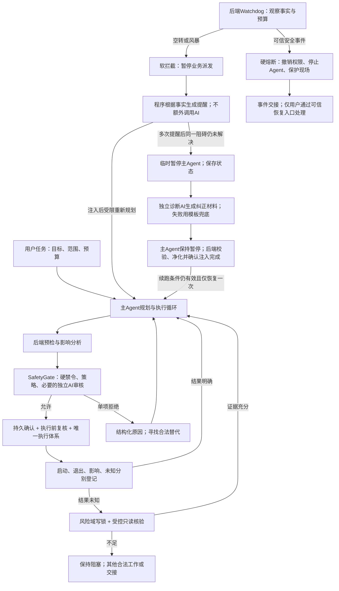

# CloudHelm：安全审核、拦截纠正与自主执行统一设计

> **状态：目标设计，尚未整体实现。** 合并用户提供的安全架构、运行连续性、三层拦截方案，以及后续确认的交互要求和研究修正。
> 源码对照基准：CloudHelm 0.2.4，`repair/comprehensive-audit`，`a50fae2`。
> 本文是后续开发的统一目标入口；当前产品行为仍以源码、[安全边界](SECURITY.md)和[整改进度](REPAIR_STATUS_OVERVIEW.md)为准，不把设计当作已上线功能。

## 0. 先用通俗的话说清楚

**用户交出任务后，AI自己推进：危险操作由工具把关，走偏了先由程序提醒，多次提醒无效再让独立诊断AI介入，结果不明先查清，真正发生安全事件才熔断。做不完也保存进度、说清原因，不莫名其妙停掉。**

- **审核AI**回答：这项操作能不能执行？
- **诊断AI**在程序多次提醒仍无效时介入：先临时暂停主Agent，独立生成纠正材料；后端校验并注入完成后，再让主Agent继续。
- 三个AI角色可在设置中选择模型；审核与诊断可跟随当前主聊天模型，但各用独立会话和权限。
- **主Agent**负责：完成任务、调用工具、按诊断建议调整方向。
- **后端**负责：最终授权、派发、拦截、状态、写锁与恢复，不能让AI自己批准自己。
- 模式3不问“这条命令批不批准”；确实缺少任务方向或细节时可以澄清。
- 一条命令被拒，不等于整个任务停止；软拦截纠正方向，硬熔断停止自主运行。
- 所有重试、诊断与恢复都有预算，不能为了“自主”无限烧钱或冒险执行。

---

## 1. 总体架构：四条安全线，加一条运行连续性主线

| 设计线 | 解决的问题 | 核心机制 |
| --- | --- | --- |
| 执行控制 | AI能做什么 | 作用域、AST语义、硬禁令、独立审核、SafetyGate |
| 凭据隔离 | AI能拿到什么 | SSH认证隔离、操作绑定私密输入、受控秘密引用 |
| 数据隐私 | AI能看到什么 | 敏感路径、模型交付前净化、按用途受控披露 |
| 审计与证据 | 实际发生了什么 | 派发前持久确认、执行阶段、结果/影响分离、未知写锁 |
| 运行连续性 | 遇到障碍后怎么继续 | 程序提醒优先、必要时独立AI诊断、有界纠正、核验、checkpoint、受控续跑 |

执行权限与隐私模式是独立维度。开启自动执行不意味着可以暴露秘密；严格隐私也不代表自动批准操作。



图中的恢复与纠正不是放行令牌；任何新操作仍经过同一套安全门。

## 2. 三模式的统一语义

### 2.1 目标矩阵

| 场景 | 模式1：人工把关 | 模式2：AI审核 | 模式3：自主执行 |
| --- | --- | --- | --- |
| 已证明的有界普通查询 | 工具可自动允许 | 工具可自动允许 | 工具可自动允许 |
| 已明确的低风险普通写入 | 按有限策略自动处理 | 按有限策略自动处理 | 按有限策略自动处理 |
| 高影响或效果需要判断 | 人工审批 | 独立审核，必要时转人工 | 工具结合独立审核自行允许或拒绝，不转人工 |
| 审核无法确定/失败/超时 | 不放行，按人工流程处理 | 不放行，可转人工 | 不放行；诊断、合法替代或明确阻塞 |
| 命中硬禁令/凭据保护/强制deny | 拒绝 | 拒绝 | 拒绝 |
| 已派发变更结果未知 | 写锁与核验 | 写锁与核验 | 写锁与自动核验，不自动风险接受 |
| 缺少业务方向或必要参数 | 可以澄清 | 可以澄清 | 可以澄清 |

说明：模式1沿用项目“重要操作询问”的心智模型，不宣称每个写操作都问人；如另要“所有写入必问”，需单独明确策略并迁移。本文重点改变模式3：不能保留“高影响就问用户”，也不能保留“未知效果直接允许”。

### 2.2 模式3的交互边界

- 可以问：“操作哪个已授权服务？”“使用哪个域名？”“部署到哪个已授权环境？”
- 不可以问：“这条命令有风险，是否继续？”“审核失败，是否跳过？”
- 业务回答改变的是目标/参数，不直接增加权限、解锁未知结果或覆盖硬禁令。
- 不因拒绝次数、审核故障或软拦截自动降到人工审批模式。
- SSH密码、验证码、指纹确认、vault解锁属于认证/信任交互，不属于澄清。模式3优先使用已建立信任与有效私密凭据，缺少时明确阻塞；是否保留专用认证弹窗作为产品例外，须另行决定，不默认加入。
- 硬熔断后的用户恢复属于**安全事件处置**，不是命令审批，也不能靠普通拒绝频繁升级来变相索批。系统发通知并保留现场，不在无人值守循环中反复询问。

## 3. 三层拦截，以及独立的结果核验状态

### 3.1 总表

| 机制 | 典型原因 | 拦截对象 | 后续动作 | 谁能恢复 |
| --- | --- | --- | --- | --- |
| 执行前拒绝 | 单项越界、危险、未获得合法授权 | 本次操作 | 返回原因；主Agent可寻找真正安全的替代 | 没有“解冻”；新操作重新过安全门 |
| 软拦截 | 重复失败、空转、请求风暴、资源消耗无进展 | 新的业务派发；升级诊断时另临时暂停主Agent | 先程序提醒，多次无效再独立AI诊断；注入完成后受限重新规划 | 后端验证条件后自动恢复 |
| 硬熔断 | 可信的安全边界攻击或严重失控事件 | 主Agent及其执行/自动恢复权限 | 停止自主运行、处理在途操作、证据与交接 | 仅用户经可信恢复入口处理 |
| 结果核验 | 已派发操作结果未知/可能部分生效 | 相关风险域的新写入 | 保留锁，只读核验，不盲目重放 | 后端依据操作专属证据收敛 |

结果核验不是第四档拦截强度，也不等于AI失控；它是与拦截状态并存的效果约束。

### 3.2 选择原则

1. 能确定只是本条操作不允许，就只拒本条，不默认结束整个任务。
2. 出现低效行为，暂停业务派发并纠正，不自动认定AI被劫持。
3. 存在未知效果，先核验，不让重试绕过写锁。
4. 可信安全事件才进入粘性的硬熔断；暂时服务故障可记为安全能力不可用的阻塞，不一律要求人工解除熔断。
5. 不用“AI是好意还是恶意”作为判定依据；依据可观察操作、权限、执行阶段、证据和系统完整性。
6. 拦截时机不能证明是否已有伤害：被挡住的攻击可能尚未生效，软拦截前的重复操作也可能已有影响，应分别登记事实。

## 4. 执行前控制：统一安全门

### 4.1 分析与仲裁顺序

1. 检查任务授权、目标身份、当前代次、预算、安全组件与已知阻塞。
2. 对命令使用真实AST解析；分析包装器、目录/身份变化、重定向、命令替换、嵌套与复合结构。
3. 汇总业务影响：读/写/删除、敏感读取、外传、代码执行、持久化、范围与未知项。
4. 先执行不可覆盖的硬禁令和受保护资源策略，再处理可信deny/ask/allow规则；allow不能覆盖底线。
5. 已证明有界低风险的操作按模式处理；灰区交独立审核器或模式1/2人工流程。
6. 允许后等待持久审计确认；派发前重新验证内容、身份、目录、策略、连接/终端代次和依赖资源版本。

解析失败不执行。单命令最大风险是基础，还要分析组合新增效果，例如读取秘密后外发、下载后执行。AST覆盖完整不等于远端运行时已被证明安全。

### 4.2 间接执行与授权绑定

- 识别Shell内嵌命令、支持的包装器、小型脚本与项目代码入口；支持范围外保留未知。
- 文件上传、服务操作、受控编辑、恢复和后台停止都使用统一授权体系，不只检查Shell文本。
- 远端脚本内容检查及执行前哈希复核不能消除所有并发替换窗口；不宣称通用Shell沙箱。
- 批准/自动授权绑定完整操作、任务、主机、目录、登录与目标身份、策略版本、连接/终端代次及相关内容版本。
- 缓存可以复用静态分析或有界审核建议，不能仅凭命令hash复用旧执行许可。
- 强制规则失败关闭；项目文件和远端输出都不能自行修改安全策略或生成授权。

### 4.3 用户授权不是任意手段授权

“删了重配”表达业务目标，仍需解析具体对象、范围和恢复方式；不自动批准目录级递归删除。拒绝时返回规则ID、具体原因、已知事实和安全替代提示；新方案仍经安全门，不允许换身份、换工具、编码或拆分来完成同一禁止效果。

模式1/2审批展示语义摘要，同时允许展开精确命令/diff。未来TTL授权模板要有范围、次数和失效规则，不从自然语言批准自动生成无限通配权限。

## 5. 软拦截：先程序提醒，再按需独立AI诊断

### 5.1 触发信号

可配置的候选信号包括：

- 相同条件下重复操作，失败结果没有实质变化；
- 多次命中相同失败模式，没有新的环境/依赖事实或有效策略变化；
- 同一资源反复改回原状态，且不属于预先声明的测试/恢复流程；
- 单位时间同类派发异常增加，或大量预算消耗但没有可验证进展。

原方案的“3次重复、5次同失败、60秒50次、消耗40%无进展”可作为校准候选，**不是已验证的默认安全定律**。未知变更第一次就锁，不等这些阈值。

归一化只合并能够证明等价的写法，不随意删除变量、排序参数或忽略目录/身份/目标。计划文本变化不算真实进展；改变指纹也不必然是有效新策略。

合法轮询、错误逐步收敛、批量工作应结合已登记计划和后端事实判断。只读操作也有CPU、网络、调用和日志成本，不得无限豁免风暴控制。

### 5.2 独立诊断AI的职责

| 项目 | 约束 |
| --- | --- |
| 介入时机 | 程序多次提醒后，同一阻碍仍未解决；先确认主Agent临时暂停，再调用诊断会话 |
| 会话 | 与主Agent、审核器分离；模型可单独指定或跟随主聊天，复用模型不复用对话 |
| 权限 | 无业务执行工具、无Shell/SSH写入、无策略/锁/解冻接口 |
| 输入 | 目标与边界、阶段、失败原因码、尝试史摘要、有限净化观察、剩余预算和未知项 |
| 不输入 | SSH/交互密码、秘密真值、完整无界日志、不必要的脚本正文 |
| 输出 | 卡点、已尝试方向、证据引用、缺失信息、少量下一步建议与不确定性 |
| 定位 | 只提供建议，不宣告主机安全、不授予执行许可、不解除写锁 |

远端输出、脚本注释、主Agent规划和诊断建议均按不可信数据处理。诊断会话没有审批权，不能把“建议继续”当成安全门allow。

输出采用有界结构，形如以下字段；这是目标契约示意，不表示当前SDK/API已实现：

```json
{
  "correctionId": "backend-issued-id",
  "summary": "当前问题摘要",
  "evidenceIds": ["backend-observation-id"],
  "failedApproaches": ["已尝试但未解决的方向"],
  "missingFacts": ["仍缺少的事实"],
  "suggestions": ["先做获准的有界观察，再据结果修改方案"],
  "uncertainties": ["不能据现有结果判断原变更是否完成"]
}
```

ID和证据由后端提供/核对，拒绝伪造引用、超长结果或越权指令。诊断超时、格式错误、预算不足时，用确定性模板注入已有事实，不反复换模型重试，不自动切换计费来源。

### 5.3 软拦截流程

1. 后端设置业务派发屏障、记录触发事实，撤销旧待派发意图；在途操作继续按其真实生命周期管理。
2. **不要把一个工具调用永久挂在冻结队列上。** 及时返回“本次未派发/需要纠正”的结构化结果，在模型工具边界收敛，避免主Agent等待工具、工具等待新规划的死锁。
3. **先由程序提醒，不额外调用AI。** 根据观察事实和模板指出重复点、错误码、已有结果与可行诊断入口。例如：“同一查询连续失败，错误类型相同，没有新的环境观察，请先检查已有日志，不要原样重复。”程序只说明能够证明的事实，不编造业务根因。
4. 注入提醒后，主Agent在受限重新规划阶段调整；后端检查有没有新事实、有效前提变化或真正不同的合法方案。有效则恢复，新的操作仍逐条经安全门。
5. 同一阻碍经多次程序提醒仍未解决，先**临时暂停主Agent**：阻止新的主模型请求与工具派发，将当前模型/工具调用收敛到可确认边界，保存状态；不销毁任务或会话，也不默认停止已经派发的远端程序。确认主Agent暂停后，才在独立、有预算的诊断权限下调用**诊断AI**。材料包含此前提醒、提醒后的尝试和结果，避免重复已试建议。
6. 诊断期间主Agent保持暂停。后端校验诊断结果，将“事实、卡点、已试方向、建议与未知项”标注为纠正材料，先以不触发运行的方式注入当前有效会话并确认完成，不替换系统安全指令。仅生成文本或收到诊断回复不算注入成功。
7. 注入完成后，后端复核用户未停止/撤权、无硬熔断、任务代次与预算仍有效，再恢复主Agent一次，让它依据新材料重新规划。必要查询仍经过隐私、风险锁和预算检查，不默认开放写入；候选操作仍由后端重新判定。诊断建议无效或没有合法下一步时，保存交接或处理确实独立的合法工作，不反复让三个角色互相讨论，也不弹命令审批。

两级计数分开：程序提醒次数与诊断AI调用次数都持久保存。建议初始上限为**程序提醒2次、仍无效再诊断AI介入1次**，具体数字待校准，不当作用户已确定的固定阈值。程序提醒不消耗独立诊断请求，但主Agent处理提醒的推理仍计入任务预算。新ID、改措辞、换工具或重启不得清零同一阻碍的计数；全任务另有累计上限。

这个渐进流程只处理空转、低效或无进展，不能延迟硬禁令执行、unknown写锁或可信安全事件熔断；也不能因提醒次数没用完就重试可能已生效的变更。

**恢复不等于回放冻结前排队的命令。** 旧队列必须丢弃或失效，新的有效意图重新审核后才可派发。软拦截也不能解除unknown写锁或硬熔断标记。

### 5.4 防遗忘与防耗费

完整纠正史（程序提醒、诊断介入及其后续结果）留在后端持久记录；每次请求按需重建有界的当前约束、纠正摘要、两级次数和证据引用。上下文压缩可以压缩文字，不能清掉后端计数和未解决约束；不依赖SDK提供一个“所有纠正永久不可压缩”的标记。

冷却只是一种有界调度措施，不保证模型“冷静”或循环自动消失。到期要重新核对任务、权限和预算，不让主循环在冻结期间无限生成规划。用户停止/撤权必须打断诊断与纠正，迟到回复不得复活任务。

### 5.5 诊断暂停与恢复的严格顺序

**临时暂停主Agent → 独立诊断生成 → 后端校验与净化 → 注入完成并确认 → 复核继续条件 → 主Agent继续。** 主Agent不能在诊断生成或注入尚未完成时并行尝试其他方案。

- 自动诊断暂停与用户主动暂停/取消是不同原因。只有前者允许本流程自动恢复，诊断AI的运行能力不依赖主Agent继续运行。
- 暂停模型不证明远端进程已退出。在途远端操作继续登记真实结果；恢复前应把诊断期间新增的权威事实一并交给主Agent，关键前提改变时重新校验建议，unknown锁仍独立保留。
- 诊断失败可使用程序模板，但模板也必须完成校验与注入后才恢复；无法安全注入或预算不足以继续时，保持明确阻塞并生成交接，不能空恢复或永久显示“正在诊断”。
- 注入和恢复绑定correctionId、任务/控制代次、有效会话及相关模型配置修订。重复回复/确认最多触发一次恢复；用户停止、撤权、硬熔断或绑定失效使迟到结果无效。
- 恢复的是主Agent的受限推理与重新规划，不是直接解除业务派发屏障，更不是重放旧队列或清除风险锁。

## 6. 硬熔断：停止自主运行，保护现场

### 6.1 触发依据

| 信号 | 处理口径 |
| --- | --- |
| 可验证地尝试篡改产品自己的审计、策略、凭据或其他任务锁 | 依据实际操作及可信来源触发硬熔断；不把文档引用或普通远端日志维护误当产品边界攻击 |
| 有可信证据表明正在规避保护外发敏感数据 | 可按强制策略熔断；结合敏感资源、未授权接收方、规避行为和证据范围 |
| 已观察到严重、不可控的破坏范围扩大或边界受损 | 立即撤销相关继续权，保护现场，不等待模型辩解 |
| 审核器一句unbounded、三次不同域名外发被拒 | 是加强检查/保守阻塞的信号，不单独证明注入攻击或必然恶意 |
| 普通重试、暂时网络/审核服务不可用、一般命令被拒 | 不自动视为攻击；按单项拒绝、能力阻塞、软纠正或结果核验处理 |

系统不能保证观察任意Shell的所有运行时影响；无法观测的部分保留未知。熔断范围按受损信任边界决定：单任务、关联风险域，或整个运行组件；产品控制端本身不可信时不能只重启同一模型假装恢复。

### 6.2 熔断顺序

1. 先在执行权威处设置拒绝派发屏障并撤销运行租约/epoch，再取消排队操作、模型/审核/诊断请求和自动恢复计时器。
2. 尽力持久化FUSED及触发证据；审计写入失败时继续禁止派发，不因“没存成功”恢复。失败前未提交的证据不能假称已保存。
3. 主Agent停止产生新的业务动作；迟到输出仅净化归档，不触发工具、解冻或续跑。
4. 对在途进程按已有精确控制能力发停止请求，不猜PID、不发送任意补救Shell；停止请求由可信后端处理，不依赖模型继续推理。
5. 没派发的操作记未执行；已确认结果保留事实；已派发但无法确定的写操作保留unknown/possible和风险域锁。不能把全部操作粗暴改成unknown。
6. 后端生成事件交接包并通知用户，说明触发原因、完成与未完成、停止请求、未决影响及恢复条件。

停止本地Agent不保证远端进程退出。只读在途操作也受资源/泄露风险和期限约束，不一律无限放任。日志与通知均净化；系统通知和UI呈现是目标能力，不承诺固定0毫秒/5秒完成。

### 6.3 恢复、终止和证据导出

- FUSED是持久阻塞；主Agent、诊断AI、Watchdog及进程重启均无自动解除权。
- 用户通过可信UI/后端恢复能力显式处理，绑定事件ID、身份、当前版本和一次性动作；AI说“用户同意”不构成授权。
- 恢复先排除受损来源/组件并核验在途操作，再由可信checkpoint、其后完整操作账与新观察重建状态，发放新运行代次。
- 必要时新建干净会话，不照搬可能已被污染的上下文；checkpoint不是远端回滚，也不能删除其后的真实影响记录。
- 解除熔断不自动解除unknown写锁。未决效果证据不足时继续阻塞；若另提供显式风险接管，须独立审计且保留原未知事实，不能冒充核验成功。
- 终止任务不清除跨任务/风险域未决锁，不默认标记“用户已知情所以安全”；导出报告不解除熔断。
- 保存完整必要事件链及证据引用，界面可只展示最近若干项；“最近20条”是展示上限，不是唯一留证范围。导出同样执行净化和访问控制。

## 7. 结果未知：先核验，不靠模型猜测解锁

### 7.1 失败分类

| 执行事实 | 允许的后续动作 |
| --- | --- |
| 可信证明未派发/业务未启动 | 修正或有界重试，新操作重新审核 |
| 已证明无业务变更的查询失败 | 按错误类型、取消与预算决定重试 |
| 已派发，效果未知或可能部分生效 | 锁住风险域，受控只读核验；不能普通重试 |
| 已知部分效果 | 按当前事实制定新的修复/继续操作，逐项审核 |
| 用户取消、撤权或人工接管 | 停止相关自主继续权，不能当瞬时错误恢复 |

非零退出不证明无影响；网络/IPC超时不证明对端没执行。核验失败后仍是unknown，不能转入可重试的普通失败分支。

### 7.2 自动核验的证据要求

由后端定义操作专属的原版本、预期状态、目标身份、进程/事务收据与观察动作。核验结果区分：已生效、已确认未启动、影响已明确、仍无法判断。

一次ls/stat或服务active只证明有限目标状态，不普遍证明原进程已退出或没有其他影响。没有活跃completion promise也不等于远端已退出。

证据足够时，先按持久一致的协议登记解决结果，再允许相应写锁释放；模型的解释、诊断建议或一句“完成了”不直接解锁。任意Shell无法核验完整效果时可以保持unresolved。

当前锁以主机/关联风险域为保守边界，不只是阻止同一条命令重复；锁期间仍可做获准查询、日志分析和确实独立的合法工作，不凭模型声称“不相关”就缩小锁。

## 8. 凭据、秘密引用与隐私

### 8.1 三类凭据分开

- **连接凭据**：SSH密码、私钥与口令由桌面安全组件管理，不进入模型上下文。
- **交互认证回答**：使用结构化认证/可信askpass私密通道，绑定操作与接收方；普通输出的Password不能单独触发索密，密码不得进入业务PTY/stdin。
- **持久服务秘密**：用后端secretRef表达，并按程序、用途、主机、身份、目的地、版本、次数和TTL限制使用。

不为模式2/3自动改sudoers为global缓存；沿用操作级认证与有界缓存并说明内存驻留风险。Linux凭据存储需识别不安全/未知后端，不能只检查“加密API可用”。连接复用沿现有ssh2路线，不为本设计强行迁移ControlMaster。

### 8.2 秘密引用不是Shell字符串替换

不以通用 `cmd.replace` 注入秘密，不把环境变量视为普遍安全。根据受支持适配器使用私密管道/文件描述符等机制；不支持的用途拒绝。

引用用后端不透明ID，或在限定授权域内使用HMAC，不暴露低熵密码的短明文hash。主动vault保存与被动检测可共用后端引用服务；UI通过窄IPC按单个引用限时查看，不把全部真值映射表放进renderer。

AI生成新密码应改为请求本地安全生成或用户私密填写，不让模型生成已知真值再假装从未披露。秘密版本或接收用途变化使旧授权失效。

### 8.3 数据保护边界

- 覆盖主模型、审核AI、诊断AI、摘要/压缩、工具结果、结构化数据、引用、错误、持久历史与恢复。
- 净化应发生在进入模型及其会话持久化之前，不能只依赖可能晚于落盘的输出hook。
- 保留现有跨块/跨行、ANSI、长行溢出与尾部净化；补结构化格式和已知值匹配，但不承诺任意秘密识别。
- 严格隐私默认；主机/项目设置可继承全局，但低级别配置不能放宽强制保护。宽松披露应用数据须明确范围/接收方，不改变认证秘密底线。
- 已进入模型或服务端的数据不能靠开关撤回；必要时新建会话并说明旧披露仍存在。
- 不因文件扩展名直接停用所有检测，不默认在线验证发现的密钥；缓存需绑定主机、版本及检测规则。
- 任意程序可编码、拆分或外发数据，字符脱敏不是远端沙箱；高保密任务仍需远端身份、文件和网络权限约束。

## 9. 文件事务与远端补偿措施

- 保留受控读取→完整diff→后端editId→新精确审核→版本/元数据复核→提交读回→显式恢复链路。
- 截断/脱敏内容不能用于无损整文件覆盖；秘密字段修改需私密能力，不让模型用占位符拼回原文件。
- 不能证明保留ACL/xattr等要求时拒绝提交，不以删除重建、通用root Shell或SFTP覆盖绕过。
- 原子rename/交换不是跨进程CAS；路径竞争、交换后异常和收据丢失仍可能unknown，不自动重放或反向交换。
- 配置语法、服务状态、业务健康与用户目标分别记录；备份/恢复收据不等于通用服务回滚。
- 优先低权限专用账户、有界目录与必要网络范围；可用时考虑正确语义的dry-run/候选校验，不假设所有程序的-n都安全。
- trash/快照须同文件系统、私有权限、容量/保留/恢复策略明确；不默认mv到/tmp，不自动创建无界或可能泄露秘密的备份。

## 10. 运行连续性与任务完成

### 10.1 不把一轮回答结束当作整个任务完成

分别记录模型轮次结束、步骤结果、目标观察和整体任务结果。必要条件未满足时不能因回答完整就标记成功；可选步骤失败也要说明影响。

任务存在合法下一步时继续推进；没有合法可运行步骤时等待事件或生成交接，不忙轮询、不反复请求模型“再想想”。

### 10.2 分层重试与预算

HTTP尝试、模型轮次恢复、远端操作、只读核验、进程重启分别有预算，并共同受任务的请求/费用/累计token/时长硬限制。审核、诊断、压缩、重试和收尾全部计入。

HTTP受限重试不能扩成整轮prompt/工具重放；流中断后保留已确认结果，残缺工具调用不执行。退避带jitter与合理Retry-After；认证失败、额度不足、撤权和硬禁令不做普通重试。

等待计划持久化retryAt，可取消；到期重新验证租约、预算和策略，不靠睡几分钟自动解锁。预算用尽后由后端模板生成交接包，不为了总结越限再调用模型。

### 10.3 上下文压缩与持久检查点

复用Pi原生压缩和容量预留，不固定按75%一刀切。压缩只减少活动上下文，不返还费用/调用额度；巨大单条结果用分页、限额和引用处理。

checkpoint至少绑定：目标/策略修订、步骤依赖与状态、已知操作与未决锁、证据引用、候选下一步、各层预算/重试、运行owner/epoch，以及SQLite与Pi JSONL游标。

完整事实在经净化、受保留策略管理的持久层中；模型摘要只是工作视图，不是授权或执行证明。跨存储不一致要校对，不猜测成功、不忽略坏记录后重放。

### 10.4 异步澄清

问题绑定任务节点、目标与图版本。只阻塞依赖答案的节点；其他工作能否执行仍由后端验证依赖、资源冲突与权限。

非关键问题不等于可以默认选择。默认须来自明确偏好/策略且影响有界可逆，不擅自决定删除、费用、对外暴露、生产目标或权限。用户取消不当成默认同意。

现有同步ask_user不能仅靠提示词变成异步；先合并必要问题并提前诊断，再通过持久questionId/依赖调度契约实现。新契约未验收前保留现有混合工具守卫。

### 10.5 崩溃、后台与休眠

- 目标是窗口隐藏后应用保持运行，重开UI仅恢复投影；现有非macOS退出路径不等于已具备托盘后台。
- 唯一owner/运行epoch负责续跑；重启先读取权威账和仍有效任务级租约，旧worker、计时器与迟到回执不能双派发。
- 用户停止、取消、撤权和FUSED优先，进程监督器不能自动复活；监督器恢复本地控制循环，不重放远端变更。
- 合盖休眠时本地不能继续推理与联网；唤醒后核验再接续。若要求休眠中继续新操作，需要另行设计常在线运行端。
- 突然断电不能保证死前写出最后报告，应以最后确认checkpoint、保守未知窗口和恢复后补建交接包为准。

## 11. 状态与权限：一个权威体系，不叠加万能状态机

### 11.1 状态分层

| 维度 | 目标表达 |
| --- | --- |
| 步骤 | pending / running / blocked / succeeded / failed / skipped |
| 运行阶段 | executing / verifying / diagnosing / replanning / waiting_retry / compacting / recovering / idle |
| 阻塞原因 | clarification / unknown_effects / correction / policy / authentication / capability / safety_unavailable / budget |
| 安全状态 | normal / correcting / fused |
| 任务结果 | active / completed / partial / cancelled |
| checkpoint | 带修订的持久快照，不是必然暂停状态 |

上述名称是目标领域概念，需通过版本化契约和迁移接入，不表示当前TaskStatus已包含这些枚举。

### 11.2 角色权限

| 主体 | 可以做 | 不可以做 |
| --- | --- | --- |
| 主Agent | 提方案、调用获准工具、请求业务澄清、按建议修正 | 自我授权、改策略、清锁、解熔断 |
| 审核AI | 独立评估灰区，给允许/拒绝/不确定建议 | 覆盖确定性禁令、直接派发或解除锁 |
| 诊断AI | 总结卡点、证据、已试方向和替代建议 | 执行工具、批准、解冻、解锁、续跑熔断任务 |
| Watchdog/连续性协调器 | 用后端事实触发软纠正，校验恢复条件，监督预算 | 仅凭新措辞放行、清未知锁、自动解除FUSED |
| SafetyGate/执行权威 | 最终决定授权、复核、派发和持久确认 | 安全失败自动允许 |
| 用户可信控制入口 | 澄清、停止、设置范围，处置安全事件 | 用一条聊天转述替代接收方绑定的恢复能力 |

core定义纯类型/端口/策略；application协调；adapters封装Pi/SSH/SQLite/解析；desktop Main负责装配、凭据与IPC；renderer/preload只投影contracts。沿现有模块提取职责，不给TaskRunner再塞一套通用控制中心。

### 11.3 三角色模型设置

| 角色 | 设置方式 | 会话与权限 |
| --- | --- | --- |
| 主Agent | 在主聊天中选择供应商和模型 | 使用当前业务会话及已授权工具 |
| 审核AI | 选择“跟随当前主聊天模型”，或指定独立供应商/模型 | 每次独立审核上下文，无业务工具，最终授权仍归后端 |
| 诊断AI | 选择“跟随当前主聊天模型”，或指定独立供应商/模型 | 程序提醒升级后才发起的独立诊断上下文，无执行/解冻权限 |

三个角色可以都用同一个LLM，也可以分别选择不同LLM。跟随当前聊天表示**复用选定的模型与后端凭据配置**，不把主聊天记录全部复制过去，不共享业务会话或工具能力；审核和诊断只接收各自所需的净化材料。

请求开始时解析并固定本次有效的供应商、模型、接收地址、凭据引用和配置修订，审计记录实际角色、模型、调用原因与用量，不记录凭据真值。切换主聊天模型会影响后续的跟随角色；指定模型的角色不因主聊天切换而被静默替换。

对应角色配置变化后撤销其尚未消费的旧结果，不能让迟到审核/诊断用于新配置或新任务代次，也不能为重新生成结果重放远端已执行动作。指定模型缺少必要能力、凭据或服务不可用时明确提示，不自动改用其他供应商或计费来源；审核失败不放行，诊断失败走模板/交接。所有角色调用统一计入全任务预算，并分别展示用量。

这些是目标设置和后端契约，不表示当前已经提供完整三角色配置界面。

## 12. 审计、交接与交互

审计覆盖每次请求、分类、决定、派发阶段、结果/影响、审核/诊断理由、纠正次数、模式/隐私、版本/代次、停止请求和恢复动作。命令与输出净化；不把秘密、原始错误或任意脚本正文写进审计解释。

派发前持久确认失败则不执行；执行后结果保存失败保留可能已执行的未知窗口。SQLite不保证本地管理员不能篡改，企业不可抵赖需求需另加可信锚点/导出或外部存储。

交接包至少包括：完成与未完成、卡点、已试方向、已知/未知影响、未决锁、证据引用、预算、最近可信checkpoint、恢复条件和可行下一步。模型离线也能生成基础交接。

| 状态 | UI目标 |
| --- | --- |
| 单项拒绝 | 活动流记录，通常无弹窗，Agent尝试合法替代 |
| 软纠正 | 先显示“程序已提醒调整”；升级时显示“主Agent已临时暂停，正在AI诊断”；注入完成再显示“已恢复调整”；分别记录次数与恢复依据 |
| 澄清/无出路交接 | 异步提示需要什么业务信息或外部条件，不伪装成命令审批 |
| 结果核验 | 显示正在确认哪个操作、写入为何受限 |
| 硬熔断 | 明确安全事件通知和恢复入口；不能静默，也不重复轰炸通知 |

## 13. 当前实现与新增工作

| 范围 | 基准已有 | 仍需开发/验收 |
| --- | --- | --- |
| 执行底座 | AST、SafetyGate、精确绑定、持久确认、独立审核 | 模式3零审批迁移、更多语义覆盖与真实组合验收 |
| 认证与数据 | 私密sudo/SSH交互、敏感路径、流式净化 | Linux后端检查、全出站通道盘点、受控secretRef与秘密编辑 |
| 结果治理 | 风险域写锁、派发恢复、日志与证据登记 | 稳定目标收口、操作专属强自动核验、受限观察阶段 |
| 文件事务 | 有界读取/diff、受控提交/恢复及元数据守卫 | 真实Linux/LSM/ACL/PAM、竞争窗口和恢复清理策略 |
| 连续性 | Pi循环、受限HTTP重试、原生压缩、持久会话 | 结构化checkpoint、预算收尾、唯一owner自动恢复、目标完成判定 |
| 软拦截 | 重复失败/无进展等保护基础 | 程序模板提醒、提醒无效升级诊断、两级计数、有界恢复与队列失效协议 |
| 角色模型配置 | 主聊天模型选择与独立审核源基础 | 统一三角色设置、审核/诊断跟随聊天或指定模型、独立会话与配置失效规则 |
| 硬熔断 | 审核取消、租约/控制权与停止机制基础 | 可信事件分类、持久FUSED、紧急停止与专用恢复能力 |
| 澄清与后台 | 同步澄清、utility进程及UI状态 | 异步依赖调度、托盘后台、休眠恢复与真实崩溃验收 |

原有 `record_reconciled_result` 的证据资格与模型解释，不能原样当强自动核验器；现有回答完成状态也不当作任务成功。两者是无人值守能力的重要前置。

## 14. 实施顺序与验收

### 14.1 分期

| 顺序 | 工作包 | 对接现有整改 |
| --- | --- | --- |
| P0-1 | 固定模式3与授权/任务控制矩阵，撤销旧审批和排队意图 | A05–A07/B08/H01/H04 |
| P0-2 | 稳定目标、执行环境、未知核验和持久checkpoint基础 | A01/B01–B07/D01–D02/H01/H02 |
| P0-3 | 全部AI调用预算及无模型交接；认证/隐私底线修补 | A04/F01/H05 |
| P1-1 | 程序提醒优先、升级诊断、三角色模型配置、软纠正屏障/恢复与两级上限 | A07/H01/H02/H05下新增明确子包 |
| P1-2 | 持久硬熔断、精确停止、隔离恢复与事件交接 | C06/C07/H02/H03/H04下新增明确子包 |
| P1-3 | 文件事务实机、强核验、唯一owner恢复与后台生命周期 | C03–C05/H03/H04 |
| P2 | 受控秘密能力、异步澄清/工作图、可选常在线运行端 | 单独子包/立项，不冒充原UI整改已包含 |

基础隐私、审计失败关闭、未知写锁、停止优先级和预算从第一阶段保留；不为了MVP后补这些底线。H05费用硬限额完成前，不做真实付费模型实验；SSH先独立确认指纹。

### 14.2 最小验收场景

1. 模式3高影响、未知语义、审核超时/故障等路由都不调用命令审批；允许澄清但不能据答案直接放行。
2. 单项拒绝后可用合法替代继续；硬禁令不会被拆分、包装或诊断建议覆盖。
3. 重复无进展先触发程序模板提醒，此阶段诊断AI请求数为0；多次提醒后同一阻碍仍未解决才升级诊断。独立诊断无工具权限，后端验证主Agent调整后的候选再逐条审核。
4. 冻结工具不永久悬挂；旧排队命令不自动补发；仅换指纹不能解冻；未知锁/FUSED不能被软恢复覆盖。
5. 程序提醒与诊断介入分别受上限控制，建议初始2次提醒后最多1次诊断，耗尽则交接；诊断离线/错误/额度不足不反复调用；所有模型调用同计且取消后迟到结果无效。
6. 压缩/重启后纠正次数、未解决约束和证据仍在；不靠无限不可压缩消息维持安全。
7. 合法轮询与收敛迭代不过度冻结，同时只读风暴仍受资源限额。
8. 可信边界攻击触发FUSED并持久化；Agent伪造“用户同意”无效；换任务/进程不能自动恢复受影响边界。
9. 熔断时停止请求不等于退出；未派发/已完成/未知分别保留；终止任务不清未决锁。
10. 写操作断线后不重放；核验证据无关/不足时仍unknown；已知进程仍运行不能因目标存在解锁。
11. 至少30步且压缩一次的任务不重复变更；回答结束与任务完成分开；预算耗尽有交接。
12. 用户停止、接管、撤权优先于重试/诊断/监督恢复；两次恢复同时到达只有一个owner。
13. 窗口后台清醒运行、休眠唤醒、worker崩溃、断电恢复分别验收，不承诺休眠中本地继续推理。
14. 文件竞争、元数据不支持、收据丢失、SQLite失败和JSONL不一致安全阻塞，不自动回滚或猜测成功。
15. 所有AI出站、会话历史、诊断/审核/摘要、通知与导出均用合成秘密回归；专用认证回答不进入模型和普通Shell。
16. 三角色可共用模型也可分别指定；共用时会话/权限仍隔离。主聊天切换只改变后续跟随角色的模型选择，不静默替换固定选择；对应在途旧结果失效，角色用量可分别追踪。
17. 程序提醒能解决时不调用诊断AI；程序提示只包含可验证事实，多次提醒无效才升级。改ID、压缩或重启不清两级计数，诊断建议也不能解除unknown写锁或硬熔断。
18. 诊断会话启动前主Agent已暂停；诊断生成、校验和注入期间，主Agent不发新模型请求或工具操作。注入确认前零恢复，确认后最多恢复一次；用户停止、硬熔断、注入失败或绑定失效时不得自动续跑。在途远端结果不因模型暂停丢失或被重放。

核心安全回归目标为：未知变更重放、重复派发、错误解锁、越权恢复、取消后复活和合成认证秘密泄露均为零。完成率、误拦率、纠正成功率、耗时和费用作为配套指标，而非替代安全底线。

## 15. 来源与验证说明

- [安全系统比较研究](SECURITY_SYSTEM_COMPARATIVE_REVIEW.md)：安全底座、模式3及凭据/数据改进依据。
- [运行连续性研究](AGENT_CONTINUITY_DESIGN_REVIEW.md)：重试、核验、checkpoint、任务完成与恢复依据。
- [当前安全边界](SECURITY.md)、[受控文件编辑](CONTROLLED_FILE_EDITS.md)、[专项验收](SECURITY_RUNTIME_ACCEPTANCE.md)、[整改进度](REPAIR_STATUS_OVERVIEW.md)：现状与待验收边界。

此前两批本地定向回归分别为5文件68项、10文件86项通过，只证明各自基准机制，不代表本文目标已实现或完整系统验收。此前整理阶段仅合并文档；本轮按用户确认更新§16的延期归属、统计及对应回归，不代表业务实现或产品验收进展，不新增库、不运行模型/SSH，不改业务、配置、版本或数据库。

## 16. 旧整改任务的取舍：停止重复建设，不取消安全目标

> **用户已确认执行延期安排**：下列冲突/重复旧路线暂不实施，由新版本接手，不计旧版剩余。保留42个原父项ID及12个UI细化包，不把移交记为完成；F05/G01/G02整项、U06整包标为“延期转新版”，其余仅移交指定子项。旧版范围39父项，按原推进口径已完成或已实现23项、仍需推进16项。核对基准仍为`a50fae2`，不代表新版已修复。

### 16.1 已确认暂停的旧路线，合入新版本一次完成

| 涉及原任务 | 旧路线/可避免的重复工作 | 新版替代目标 | 不能一并删掉的部分 |
| --- | --- | --- | --- |
| A06/A07 | 模式3继续保留高影响人工批准、审核故障转人工，以及未知效果直接允许；不必为这些旧语义再做完整产品收尾 | 模式3工具自主判定，无法获准则拒绝/诊断/阻塞；无命令审批 | 模式1/2人工审批；硬禁令、作用域、审核取消/失效、迟到结果隔离 |
| A07/B08及TaskRunner协调 | 固化“连续三次AI拒绝/同类失败就整轮暂停、等用户继续”的统一处理 | 按影响分流；普通空转先程序提醒，多次无效再暂停主Agent、独立诊断、注入确认后继续 | 防循环预算、未知效果保护、用户停止、人工接管和安全故障失败关闭 |
| B04/B06/C06关联恢复交互 | 将所有unknown都固定为“整轮停住、只等用户点继续”，并为此单独扩展旧流程 | 保留风险域写锁，进入有权限的只读核验阶段；证据充分才接续，查不清交接 | B04未决判定、B05防重放、B06风险释放事实、C06后台进程存活约束；不是取消这些父项 |
| F05/U06、U07中与运行控制有关的部分 | 先按旧的运行/暂停/等待审批布局全部做完，后续再重画诊断与恢复入口 | 统一展示程序提醒、主Agent诊断暂停、注入后恢复、核验、澄清与硬熔断 | 用户停止入口、真实远端状态、键盘/IME、发送补充、草稿和可访问性等独立功能 |
| G01/G02，关联F05/U05 | 仅围绕一轮回答和旧报告卡片做最终状态收尾，再增加任务结果和交接包 | 一次完成“回答结束≠任务完成”、事实/解释分层、partial交接与证据按需展开 | 真实执行/目标观察/风险接受的区分，已存在的事实账；不恢复强制模型交报告 |
| H01/H04及H03最终场景 | 先定版旧暂停状态契约、旧模式3策略与其专属验收，再为新版重新迁移/验收一遍 | 先定义新版契约与迁移边界，再按新目标做最终组合验收；旧记录保守兼容 | 所有数据库变更的版本化迁移、故障回归、真实SSH/权限/断线/停止验收 |

上述部分有些是**当前已有代码行为**，并非旧任务本身要求必须保留；旧任务的上层目标与新设计大多一致。本轮确认停止的是继续强化这些旧行为的新增开发和重复收尾，不是立刻删除现有防护代码；具体NV01–NV06承接编号见[延期登记与旧版剩余表](REPAIR_STATUS_OVERVIEW.md)。

独立审核器“跟随主聊天/指定模型”的已有能力继续复用，不另做一套仅审核专用的新配置页；设置改造合入§11.3三角色配置，保留独立会话、凭据绑定及故障不换计费来源。

### 16.2 必须保留的前置与验收，不能靠“等新版”略过

| 原任务范围 | 仍必须完成的原因 |
| --- | --- |
| A01、A03/A04、A05 | 稳定目标、用户意图来源、净化和统一影响事实，是主/审核/诊断三个角色共用的底座 |
| B01–B07的执行事实、去重、未决锁与派发前复核 | 新版自动恢复依赖它们；只替换部分人工等待流程，不能删除安全目标 |
| C01–C05、C06/C07的安全文件/权限/进程控制 | 新诊断AI不能替代可靠工具、元数据保持、私密认证、精确停止和未知保护 |
| D01/D02、D03待验收部分 | 环境与实际执行不一致会直接制造重复失败，不能只靠提示词或诊断补救 |
| E02–E04及其他仍待验收的数据生命周期 | 引用、日志归属、脱敏尾部和资源限额依然有效，新增诊断还会使用这些数据 |
| H02/H03/H04/H05的安全回归、真实验收、迁移、硬预算 | 新版是更多自动操作，不是少验收；诊断/审核/重试同计，付费硬限制未完成前仍禁止实际付费调用 |

C03/C05已经有开发态提交/配置检查/恢复闭环，不必重新从零开发；剩余真实平台、竞争、清理和权限验收不能取消。C04的legacy root收敛也与新设计一致，不应为新版再扩展长期root会话。

### 16.3 可以调整优先级，但不是因为冲突而删除

F03/U01/U11的正文流式和增量性能，以及F06中Markdown、高亮、长块、表格、复制、滚动、主题与可访问性，和新版没有本质冲突。不涉及控制语义的部分仍可独立推进；若优先交付自主执行，可以排到后面，但不能记为“新版自动修复”。U12的最终专项验收随新版界面收口，现有回归保留。

异步澄清、大型依赖图、完整秘密库、远端常在线runner是新版扩展，不是已经完成的替代项，也不应拿它们当作取消旧安全修复的理由。

### 16.4 调整工作安排的执行规则

1. 保留原ID与证据；整项移交标注“延期转新版”，部分移交注明NV承接编号与保留范围，移交范围从旧版剩余排除；指定新版完成标准，不标成已修复或直接删除。
2. 新包优先承接：模式3裁决、分级提醒与诊断、核验/续跑、任务结果与交接、统一状态/模型设置、迁移及验收。可以在相应原父项下细化，不重复统计父项完成率。
3. 新替代能力及局部回归通过前，保留当前保守拦截。不能先删暂停、审批或写锁，再让现有版本无保护地等未来开发。
4. 模式1/2的审批、安全故障、用户主动停止与FUSED不纳入“自动继续”放宽；改测试时只替换已明确改变的目标断言，不删除安全反例或跳过真实验收。
5. 最终全量/组合验收可按既定安排留到新版收口，不为注定替换的模式3旧行为额外跑一轮完整产品验收；每次实际代码变更仍做相关局部验证。

### 16.5 当前统计与移交范围

- 原始42父项 = 旧版39项 + 延期转新版3项（F05/G01/G02）。后3项未完成，但不再计旧版剩余/分母，也不计完成。
- 旧版39项 = 已完成4 + 已实现待验收19 + 进行中10 + 待开始6。沿用户原推进口径，已完成或已实现23、仍需推进16；严格最终验收仍有35项未收口，不隐去19项待验收。
- 部分移交：NV01模式3裁决；NV02分级提醒/诊断与暂停替代；NV03自动核验/续跑交互；NV04统一状态/控制/模型设置；NV05任务结果/交接/证据展示；NV06新版契约/迁移/专属验收。原父项中保留的安全工作仍按旧版跟进。
- U06整包移交，U05/U07等仅移交关联展示/控制部分，其他独立功能保留。UI不叠加到父项数。
- 完整16项剩余总表、承接编号与验收边界见[整改总览](REPAIR_STATUS_OVERVIEW.md)，实施证据见[详细进度账](REPAIR_PROGRESS.md)。后续统计使用本口径，历史记录中的23/19仅代表当时范围。

**结论：旧方案的重复开发和重复收尾已确认暂缓，功能由新版承接；旧版安全底座及验收仍保留。延期是调整计划，不是声称问题已经消失。**

**一句话收口：命令由工具把关，走偏先由程序提醒，多次无效才请独立诊断AI；三个角色模型可分选也可复用，权限与会话不混用。未知先核验，安全事件才熔断；能完成就完成，不能完成也有进度、有原因、有接续点。**
