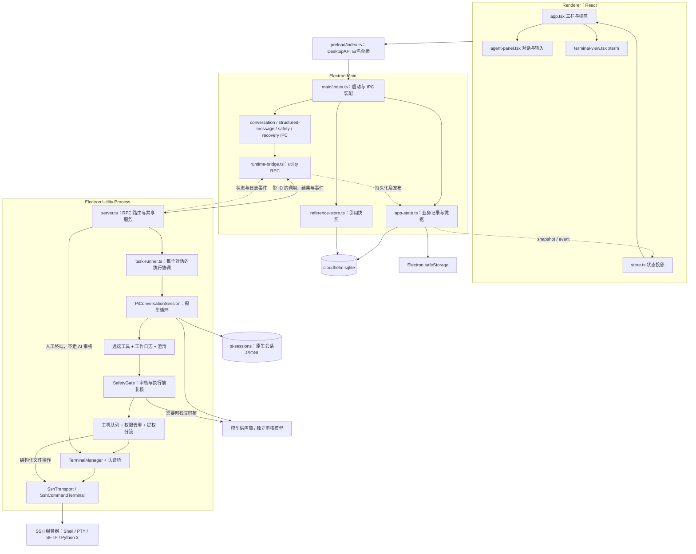
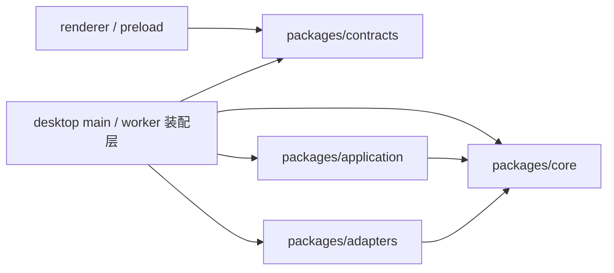
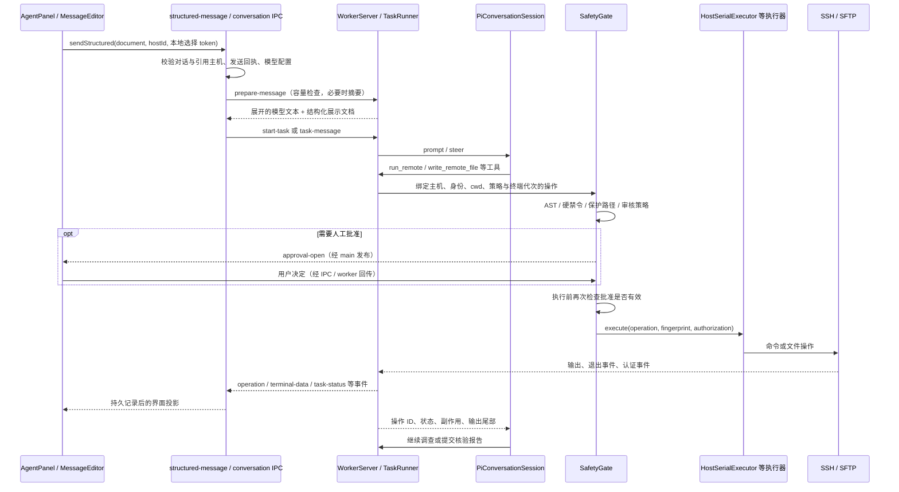
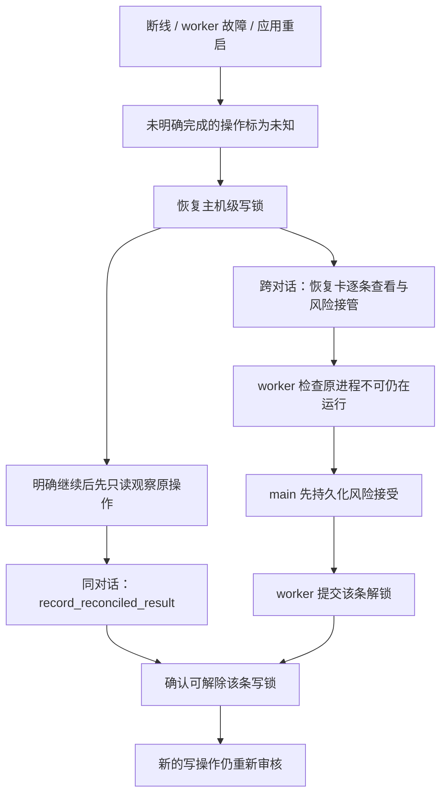
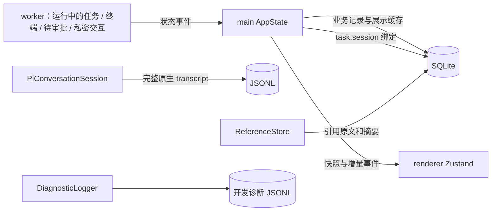

# CloudHelm 当前架构与逐文件功能地图

> 更新：2026-10-29，项目版本 `0.2.4`，包含测试集中与验收 V3 整理。本文是当前源码职责地图，不是未来设计，也不代表真实服务器、模型或安装包已经全部验收；实际结果以 [STATUS.md](STATUS.md) 为准。
>
> **阅读目标：判断“现在有什么功能、功能在哪里、哪些只是界面或协议、哪些限制仍然存在”。**
>
> 范围：逐项列出 `apps/desktop`、`packages` 的生产源码、样式、资源和包配置；补充构建与发布支撑文件。不列单元／集成测试、测试 fixture、smoke、UI 探针及测试专用配置，也不展开依赖、构建产物、缓存、历史计划和编辑器配置。文件名中的 `host-connection-test` 是产品里的“测试 SSH 连接”功能，**不是自动测试文件**，因此保留。

## 1. 先看结论：这是什么系统

当前是一个 **Electron 桌面 SSH 客户端 + 单主机 AI 操作助手**，不是 Web 后台、云端运维平台或远端常驻 Agent。

- 左侧管理主机和对话，中间是终端／文件列表／报告，右侧是 AI 消息和操作时间线。
- 用户直接聊天，后台创建 `TaskView` 执行记录；不需要先建任务。
- 人工终端与 AI 受控终端分开。AI 有多轮工具循环，但不能直接调用任意本地 Shell。
- SSH、模型请求、审批、认证交互和远端执行在独立 utility process 中运行。
- AI 远端命令、文件写入／删除／上传经过统一 SafetyGate；人工终端输入不是同一审核路径。
- SQLite 保存应用业务记录；Pi JSONL 保存原生模型会话；前端 Zustand 只是投影。
- 已有停止、恢复、未知结果写锁、核验报告、sudo 私密认证与有限 root 会话实现；没有通用后台任务恢复平台或自动回滚引擎。

### 1.1 产品能力与实现边界

这里的“已接线”表示源码中存在调用链，不是运行验收结论。

| 能力     | 当前代码做到哪里                                                                | 不能据此认为已经做到                                         |
| -------- | ------------------------------------------------------------------------------- | ------------------------------------------------------------ |
| 主机管理 | 新增、编辑、归档；修改连接目标生成修订；密码／私钥／SSH Agent；指纹与单跳板     | 任意跳板链、云资产发现或批量主机编排                         |
| 测试连接 | 对未保存表单建立临时 SSH 握手；临时指纹确认；超时清理                           | 执行命令、打开终端或永久信任该指纹                           |
| 人工 SSH | 多终端标签、xterm、输入、尺寸同步、关闭／断开                                   | 所有 Shell 都支持自动命令边界识别                            |
| AI 对话  | Pi 原生多轮会话、自定义工具、澄清、计划、模型／思考档位切换                     | 新对话跨多主机操作、任意本地工具访问                         |
| 远端执行 | 审核后独立 PTY 执行；原命令展示；退出码、失败类型和副作用状态                   | `abort()` 能证明远端进程已经终止                           |
| 审核     | 三档、硬禁令、读写保护路径、脚本检查、独立 AI 审核、精确人工复核                | 沙箱或能完全理解任意动态脚本效果                             |
| 提权     | 有界 sudo 及可解析前台列表；私密密码通道；任务内短时缓存；用户确认 root SSH／su | 自动换身份绕过拒绝、su 提升普通 SFTP 权限、所有 PAM 环境兼容 |
| 文件     | UI 只读目录浏览；AI 写／删常规文件、上传选中文件；保留恢复副本                  | 完整图形化文件编辑器、目录递归删除、通用同步或自动恢复按钮   |
| 本地材料 | 系统文件选择器授予范围；目录列举、文本分页读取、受限上传                        | 模型任意读取电脑、读取 SSH 私钥选择结果作为资料              |
| 引用输入 | 终端选区或命令范围快照、长粘贴标签、预览编辑、按容量压缩、发送去重              | 精确供应商 tokenizer、无限上下文、压缩绝不损失信息           |
| 模型设置 | API Key、Base URL、模型容量、连接检查；当前／Jev／指定模型审核                  | OAuth 订阅登录、产品订阅计费                                 |
| 恢复     | 原生会话恢复、操作未知状态、主机写锁、只读核验、逐条风险接管                    | 断线后重新附着任意旧前台进程、未知操作自动重放               |
| systemd  | 已有 `.service` 的 inspect／restart／logs，重启前后检查                       | 创建服务、安装 systemd、通用 `systemd-run` 作业平台        |
| 结果核验 | 变更后只读证据检查、结构化报告、独立 verified／unverified 状态                  | 退出码为 0 就证明目标达成；风险接管就是成功证据              |
| 发布     | macOS DMG、Windows NSIS 配置和 CI 发布流程                                      | 已签名／公证、各平台全部人工验收完成                         |

## 2. 总体架构图

### 2.1 进程、外部服务和存储



说明：图里合并了若干装配步骤，准确的执行器顺序见第 3 节。safeStorage 在主进程使用；运行所需凭据通过内部 RuntimeProfile／RuntimeHost 交给 worker，不进入普通界面快照。

### 2.2 源码依赖方向



- **Core**：业务类型、端口、纯策略及小型基础机制；不依赖桌面实现。
- **Application**：安全、终端、交互、队列等业务协调；通过 Core 端口执行。
- **Adapters**：Pi、SSH、SQLite、Bash AST 等具体技术实现。
- **Contracts**：跨进程 DTO、事件、DesktopAPI 和 runtime RPC 联合类型。
- **Desktop main／worker**：装配上述模块；所以这里既有入口，也有产品业务流程，不只是空壳。
- `.dependency-cruiser.cjs` 检查循环、反向导入与 renderer 越层访问。图表示导入方向，不是数据只能单向流动。

### 2.3 目录导航

```text
apps/desktop/
  electron.vite.config.ts       三份桌面构建入口与资源打包
  resources/                   Bash 解析语法 WASM
  src/main/                    窗口、IPC、持久状态、凭据、运行进程桥
  src/preload/                 渲染进程可用的窄 API
  src/renderer/                React 界面、终端、草稿和状态投影
  src/worker/                  SSH、Agent、安全入口的运行时装配
packages/
  contracts/src/               UI / 主进程 / worker 的通信契约
  core/src/                    领域对象、接口、安全和结果策略
  application/src/             安全门、终端控制、交互协调、执行队列
  adapters/src/                Pi、Bash、SSH、SQLite 实现
    pi-extensions/ask-user/    内置需求澄清扩展
Tests/                         自动测试、专用 fixture、smoke 与离线评估
scripts/                       版本、发布和工程维护（无测试实现）
```

## 3. 关键功能如何串起来

### 3.1 发送消息到远端执行



### 3.2 实际执行器装配顺序

以 `worker/server.ts` 构造函数为准：

```text
TaskRunner.performOperation
  → SafetyGate.execute
    → HostSerialExecutor                  同主机串行；未知写入阻断后续写入
      → PermissionAwareExecutor           同身份 Docker socket 权限失败短时去重
        → PrivilegedRuntime               普通／root SSH／su 身份分流
          ├─ 普通 FileOperationExecutor
          │    ├─ command → OperationInputBridge → TerminalManager
          │    │                                    → SshCommandTerminal
          │    │                                      → SshTransport
          │    └─ write/delete/upload → SshTransport 的受限 SFTP
          └─ 提权会话的命令／文件执行路径（su 不提升 SFTP）
```

SafetyGate 的“放行”与 HostSerialExecutor 的“可派发”是两道不同检查：一个新命令即使风险允许，也可能被同主机旧操作的未知结果阻断。

### 3.3 人工终端与 AI 终端不是同一个入口

```text
人工：terminal-view → preload → main → WorkerServer → TerminalManager.input → SSH Shell
AI：模型工具 → TaskRunner → SafetyGate → 执行器 → TerminalManager.execute → 受控进程
```

AI 活跃命令期间拒绝普通人工输入；停止按钮／Ctrl+C 撤销执行权限并尝试中断，仍要等退出观察。空闲后可转人工使用，下一轮 AI 按需建立新的受控终端。终端代次变化使旧批准失效。

### 3.4 私密认证链路

```text
SSH keyboard-interactive / sudo askpass / root 会话认证
  → worker 的绑定请求（操作、终端、接收方、有效期）
  → 主进程转发 → InputCard 独立输入
  → answerInput → 对应认证接收方
```

这不是 `sendMessage`，也不是把密码写进普通 Shell。`InteractionCoordinator` 处理过期、重复与接管失效；`OperationInputBridge` 处理 sudo 与有界 APT 确认；`SudoCredentialCache` 只在内存中保存短时、绑定作用域的已验证凭据。

### 3.5 恢复与核验



注意三个不同概念：

1. **操作成功**：命令／文件执行返回成功。
2. **目标已有观察／比较**：后端自动记录执行事实；有完整输出及绑定预期、匹配内容读回时才支持相应确定性比较，复杂语义仍为模型判断。`submit_verification` 仅是可选补充。
3. **人工接受未知风险**：只解除指定阻断，不把原操作改成成功，也不算核验成功证据。

`TaskStatus.answered` 只表示已答复；验收 V3 分别投影执行、目标观察、影响、登记，兼容保留历史 verified／unverified。缺少模型补充不构成完成门槛，普通新消息不丢弃尚未覆盖的操作或接受旧风险。符合条件的旧自动报告可只按已有记录重整，不启动 Agent／SSH／模型，原报告追加保留。详见[验收 V3](VERIFICATION_V3.md)。

## 4. 逐文件地图：桌面主进程

本节相对目录：`apps/desktop/src/main/`。

| 文件                                                                           | 主要职责与接线                                                                                                                                                                               |
| ------------------------------------------------------------------------------ | -------------------------------------------------------------------------------------------------------------------------------------------------------------------------------------------- |
| [index.ts](../apps/desktop/src/main/index.ts)                                   | 总装配入口：初始化 SQLite／AppState／ReferenceStore／RuntimeBridge；注册 IPC；主机连接与跳板、指纹信任、本地文件／私钥选择、剪贴板、系统通知、窗口安全与退出生命周期。启动恢复历史操作写锁。 |
| [app-state.ts](../apps/desktop/src/main/app-state.ts)                           | 业务状态与持久化中心：主机修订、对话、消息、操作、模型配置、审核设置、快捷键、终端日志；safeStorage 加解密；将 worker 事件写入并投影；故障恢复、历史只读重分类及删除对话。                   |
| [app-shutdown.ts](../apps/desktop/src/main/app-shutdown.ts)                     | 可取消退出确认与一次性资源关闭；区分 before-quit 与 will-quit，避免取消退出后数据库已关。                                                                                                    |
| [runtime-bridge.ts](../apps/desktop/src/main/runtime-bridge.ts)                 | 启动 utility process、带 ID 的 RPC、超时、事件／诊断转发和日志反向查询；worker 退出时拒绝未完成请求，关闭后忽略迟到消息。                                                                    |
| [conversation-ipc.ts](../apps/desktop/src/main/conversation-ipc.ts)             | 创建／发送／恢复／删除对话，校验模型凭据和单主机绑定，消费本地选择 token；协调连接与恢复去重；注册模型、思考与澄清等对话接口。                                                               |
| [structured-message-ipc.ts](../apps/desktop/src/main/structured-message-ipc.ts) | 处理富结构输入：验证片段、引用主机与模型修订，生成消息独立引用，调用容量准备；持久化 preparing／dispatching／sent／failed 回执，取消准备并阻止结果未知时自动重发。                           |
| [reference-store.ts](../apps/desktop/src/main/reference-store.ts)               | 监听终端命令起止和输出，保存命令范围日志；建立选区／命令快照；完整长度校验、脱敏与按需读取引用正文。                                                                                         |
| [host-connection-test.ts](../apps/desktop/src/main/host-connection-test.ts)     | 产品连接测试协调：校验未保存表单、凭据来源和跳板，独立测试身份；指纹确认绑定配置与凭据摘要、单次使用、限时失效。                                                                             |
| [host-safety-ipc.ts](../apps/desktop/src/main/host-safety-ipc.ts)               | 主机保护路径／默认档位及对话档位的更新接口；串行同步 worker 策略和持久状态，维护策略修订。                                                                                                   |
| [recovery-ipc.ts](../apps/desktop/src/main/recovery-ipc.ts)                     | 恢复卡读取指定操作日志；人工风险接管先让 worker 检查，再持久化，再提交解锁，避免失败时先放行。                                                                                               |
| [diagnostic-logger.ts](../apps/desktop/src/main/diagnostic-logger.ts)           | 开发诊断输出到控制台和 JSONL；日志等级／目录环境配置、字段约束、脱敏、文件轮转和写失败容错。                                                                                                 |

## 5. 逐文件地图：通信契约与 preload

| 文件                                                                            | 主要职责与接线                                                                                                                              |
| ------------------------------------------------------------------------------- | ------------------------------------------------------------------------------------------------------------------------------------------- |
| [preload/index.ts](../apps/desktop/src/preload/index.ts)                         | 将明确的 DesktopAPI 映射到 `ipcRenderer.invoke` 和事件订阅，通过 contextBridge 暴露给页面；不是通用 IPC／Node／Shell 入口。               |
| [contracts/src/index.ts](../packages/contracts/src/index.ts)                     | HostDraft TypeBox schema；主机、对话、操作、审批、输入、模型、执行、核验等视图类型；AppSnapshot／AppEvent／DesktopAPI；共享的未决结果判断。 |
| [contracts/src/runtime.ts](../packages/contracts/src/runtime.ts)                 | main ↔ worker 的 RuntimeCall／RuntimeMessage、日志页和安全配置；内部 RuntimeHost／RuntimeProfile 可携带运行所需秘密，不是 renderer DTO。   |
| [contracts/src/message-content.ts](../packages/contracts/src/message-content.ts) | MessagePart／MessageDocument／ReferenceBody，以及终端引用请求和结构化发送的跨进程契约。                                                     |
| [contracts/src/diagnostics.ts](../packages/contracts/src/diagnostics.ts)         | 跨进程诊断记录的可传输结构。                                                                                                                |

## 6. 逐文件地图：Renderer

本节相对目录：`apps/desktop/src/renderer/`。这些文件展示后端状态和发起意图，不决定审批是否有效、终端输入应投递给谁或能否远端写入。

### 6.1 入口、页面、状态与终端

| 文件                                                                             | 主要职责与可见功能                                                                                               |
| -------------------------------------------------------------------------------- | ---------------------------------------------------------------------------------------------------------------- |
| [index.html](../apps/desktop/src/renderer/index.html)                             | Renderer HTML 容器和脚本入口。                                                                                   |
| [src.tsx](../apps/desktop/src/renderer/src.tsx)                                   | React 挂载入口，加载全局样式。                                                                                   |
| [app.tsx](../apps/desktop/src/renderer/app.tsx)                                   | 三栏工作台总装配：主机、历史、终端／文件／报告标签、连接操作、弹窗、上下文菜单、面板宽度与快捷键动作。           |
| [store.ts](../apps/desktop/src/renderer/store.ts)                                 | Zustand UI 投影：接收 snapshot／event；保存终端缓冲、标签、当前对话、面板状态；避免后台事件抢走当前选中项。      |
| [agent-panel.tsx](../apps/desktop/src/renderer/agent-panel.tsx)                   | AI 侧栏：对话时间线、运行／等待状态、计划、审核交互、停止／继续、输入、附件、模型和思考选择；组装发送流程。      |
| [workspace-pages.tsx](../apps/desktop/src/renderer/workspace-pages.tsx)           | FilesPage 只读远端目录浏览；OperationCard 操作记录；VerificationCard 已核验／未核验提示；ReportPage 报告与证据。 |
| [terminal-view.tsx](../apps/desktop/src/renderer/terminal-view.tsx)               | 创建 xterm，接收输出，转发输入／协议响应，日志恢复、选区引用、菜单、粘贴、滚动及终端实例清理。                   |
| [terminal-fit.ts](../apps/desktop/src/renderer/terminal-fit.ts)                   | FitAddon 测量和尺寸观察，将可用空间转换为行列并同步远端 PTY。                                                    |
| [terminal-actions.ts](../apps/desktop/src/renderer/terminal-actions.ts)           | 按终端 ID 注册复制选区、粘贴、全选、清屏、聚焦等界面动作，供菜单和快捷键复用。                                   |
| [terminal-control.tsx](../apps/desktop/src/renderer/terminal-control.tsx)         | 根据任务与未决操作显示停止按钮，调用 stopOperation 停止当前轮；实际控制权以 backend 为准。                       |
| [host-dialogs.tsx](../apps/desktop/src/renderer/host-dialogs.tsx)                 | 新增／编辑主机、私钥选择、安全档位与读写保护路径设置、通用确认弹窗。                                             |
| [host-connection-test.tsx](../apps/desktop/src/renderer/host-connection-test.tsx) | “测试连接”的 hook 与状态组件，处理测试中、成功／失败、临时指纹确认和配置变化失效。                             |
| [ui-helpers.tsx](../apps/desktop/src/renderer/ui-helpers.tsx)                     | 异步动作错误捕获、任务／审核状态的中文标签、共享 SVG 图标。                                                      |
| [assets.d.ts](../apps/desktop/src/renderer/assets.d.ts)                           | 样式模块等前端资源的 TypeScript 声明，不是运行时功能。                                                           |

### 6.2 消息、编辑器与引用

| 文件                                                                             | 主要职责与可见功能                                                                                         |
| -------------------------------------------------------------------------------- | ---------------------------------------------------------------------------------------------------------- |
| [conversation-timeline.ts](../apps/desktop/src/renderer/conversation-timeline.ts) | 将消息、操作、澄清记录组合为有序时间线。                                                                   |
| [user-message.tsx](../apps/desktop/src/renderer/user-message.tsx)                 | 用户消息显示、复制和编辑后补发入口；不是改写已发生的远端操作。                                             |
| [message-content.tsx](../apps/desktop/src/renderer/message-content.tsx)           | 按 MessageDocument 顺序渲染文字与引用标签。                                                                |
| [message-copy.ts](../apps/desktop/src/renderer/message-copy.ts)                   | 按需读取引用，将结构化消息展开为可复制文本；区分原文与实际发送内容。                                       |
| [markdown-message.tsx](../apps/desktop/src/renderer/markdown-message.tsx)         | 助手 Markdown／GFM、代码块复制、安全 URL；不渲染任意 HTML，图片转链接而不自动加载远端资源。                |
| [reasoning-content.tsx](../apps/desktop/src/renderer/reasoning-content.tsx)       | 单独折叠显示供应商实际返回的思考内容／摘要及中断、不可用状态，不从正文推造思考。                           |
| [message-editor.tsx](../apps/desktop/src/renderer/message-editor.tsx)             | contenteditable 混排编辑器：文字＋原子引用标签、输入法与光标、长粘贴折叠、标签操作、撤销重做和发送。       |
| [message-editor-dom.ts](../apps/desktop/src/renderer/message-editor-dom.ts)       | DOM 与 MessagePart 转换、选区位置计算和光标恢复；引用按一个原子单位计数。                                  |
| [message-drafts.ts](../apps/desktop/src/renderer/message-drafts.ts)               | 按对话／新会话键保存内存草稿、片段替换、光标、版本、发送锁和压缩状态；长粘贴阈值为超过 10 行或 1000 字符。 |
| [reference-preview.tsx](../apps/desktop/src/renderer/reference-preview.tsx)       | 引用正文／摘要预览；可编辑草稿中的资料，并支持保存、删除等操作。                                           |
| [composer-controls.tsx](../apps/desktop/src/renderer/composer-controls.tsx)       | 输入区模型选择、当前主机／审核档位、上下文用量、压缩与待生效模型提示。                                     |
| [thinking-picker.tsx](../apps/desktop/src/renderer/thinking-picker.tsx)           | 按模型可用档位选择思考强度，展示 selected／effective／pending。                                            |
| [clipboard.ts](../apps/desktop/src/renderer/clipboard.ts)                         | 剪贴板读写、输入字段插入文本及复制菜单项，复用 preload 能力和界面回退。                                    |

### 6.3 审批、认证、澄清、恢复与错误

| 文件                                                                           | 主要职责与可见功能                                                                                                |
| ------------------------------------------------------------------------------ | ----------------------------------------------------------------------------------------------------------------- |
| [interaction-cards.tsx](../apps/desktop/src/renderer/interaction-cards.tsx)     | ApprovalCard 展示完整操作与批准／拒绝；InputCard 接收认证、普通确认和选择；处理过期与提交，不把认证回答作为聊天。 |
| [clarification-card.tsx](../apps/desktop/src/renderer/clarification-card.tsx)   | 普通需求澄清问题、选项和自定义答案，提交／取消到专用澄清接口；不是密码窗口。                                      |
| [recovery-card.tsx](../apps/desktop/src/renderer/recovery-card.tsx)             | 当前写入被历史未知结果阻断时逐项显示恢复卡；按需读旧日志、明确接受单项风险或继续阻断，不自动恢复 AI。             |
| [error-presentation.ts](../apps/desktop/src/renderer/error-presentation.ts)     | 将技术错误分类为用户可读标题、解释和行动建议，剥离 IPC 包装、避免展示未知响应体与秘密。                           |
| [error-control-action.ts](../apps/desktop/src/renderer/error-control-action.ts) | 根据错误上下文和当前后端状态确定可提供的停止／暂停等控制动作。                                                    |
| [error-dialog.tsx](../apps/desktop/src/renderer/error-dialog.tsx)               | 错误弹窗、详情与配置模型／控制动作入口。                                                                          |
| [use-error-notices.ts](../apps/desktop/src/renderer/use-error-notices.ts)       | 管理错误通知、上报与关闭，以及关联终端／对话上下文。                                                              |

### 6.4 设置、菜单与快捷键

| 文件                                                                       | 主要职责与可见功能                                                                                                              |
| -------------------------------------------------------------------------- | ------------------------------------------------------------------------------------------------------------------------------- |
| [model-settings.tsx](../apps/desktop/src/renderer/model-settings.tsx)       | 供应商双列设置：API Key、Base URL、模型、容量、连接测试、保存与未保存退出确认；独立审核配置及设置导航。订阅入口不是已开放能力。 |
| [shortcut-settings.tsx](../apps/desktop/src/renderer/shortcut-settings.tsx) | 按键录制、冲突提示、单项／全部恢复默认、快捷键总开关。                                                                          |
| [shortcut-store.ts](../apps/desktop/src/renderer/shortcut-store.ts)         | 快捷键配置的 Zustand 投影；读取／保存后端设置和录制状态。                                                                       |
| [shortcuts.ts](../apps/desktop/src/renderer/shortcuts.ts)                   | 动作目录、默认键位、平台格式、组合键解析、保留键与冲突检查、作用域及菜单提示。                                                  |
| [use-shortcuts.ts](../apps/desktop/src/renderer/use-shortcuts.ts)           | 全局键盘事件订阅，依据作用域和录制状态调用匹配动作。                                                                            |
| [context-menu.tsx](../apps/desktop/src/renderer/context-menu.tsx)           | 菜单项结构、分隔符规范化、右键菜单状态和统一宿主。                                                                              |
| [menu-surface.tsx](../apps/desktop/src/renderer/menu-surface.tsx)           | 菜单浮层、锚点定位、边界避让、键盘／焦点交互和共享菜单项。                                                                      |
| [anchored-menu.tsx](../apps/desktop/src/renderer/anchored-menu.tsx)         | 给按钮等锚点挂接统一 MenuSurface，避免菜单被布局裁剪。                                                                          |
| [edit-menu.ts](../apps/desktop/src/renderer/edit-menu.ts)                   | 判断可编辑目标与敏感字段，构造输入控件的剪切／复制／粘贴／全选菜单。                                                            |

### 6.5 样式文件（没有独立后端功能）

| 文件                                                                                       | 对应界面                                                 |
| ------------------------------------------------------------------------------------------ | -------------------------------------------------------- |
| [global.css](../apps/desktop/src/renderer/global.css)                                       | 全局基础样式、系统主题与通用元素。                       |
| [ui.module.css](../apps/desktop/src/renderer/ui.module.css)                                 | 工作台、侧栏、标签、终端容器、卡片和通用弹窗等共享布局。 |
| [clarification-card.module.css](../apps/desktop/src/renderer/clarification-card.module.css) | 澄清问题／选项卡片。                                     |
| [composer-controls.module.css](../apps/desktop/src/renderer/composer-controls.module.css)   | 模型选择与输入区底栏。                                   |
| [error-dialog.module.css](../apps/desktop/src/renderer/error-dialog.module.css)             | 错误弹窗。                                               |
| [markdown-message.module.css](../apps/desktop/src/renderer/markdown-message.module.css)     | Markdown 正文、表格、代码块。                            |
| [message-editor.module.css](../apps/desktop/src/renderer/message-editor.module.css)         | 富输入框与引用标签。                                     |
| [model-settings.module.css](../apps/desktop/src/renderer/model-settings.module.css)         | 供应商与模型设置布局。                                   |
| [reasoning-content.module.css](../apps/desktop/src/renderer/reasoning-content.module.css)   | 折叠思考内容。                                           |
| [user-message.module.css](../apps/desktop/src/renderer/user-message.module.css)             | 用户消息及操作按钮。                                     |

## 7. 逐文件地图：Worker 运行时装配

本节相对目录：`apps/desktop/src/worker/`。

| 文件                                                                                 | 主要职责与接线                                                                                                                                                                      |
| ------------------------------------------------------------------------------------ | ----------------------------------------------------------------------------------------------------------------------------------------------------------------------------------- |
| [runtime.ts](../apps/desktop/src/worker/runtime.ts)                                   | utility process 真正入口；取得 parentPort，构造 WorkerServer，接收调用并回传结果／错误，分派主进程日志查询结果。                                                                    |
| [server.ts](../apps/desktop/src/worker/server.ts)                                     | 进程级 RPC 路由和共享服务装配；SSH 连接池、TerminalManager、执行器链、任务表、审批／输入等待；消息准备、风险解锁、终端操作、模型检查、日志反向查询。                                |
| [task-runner.ts](../apps/desktop/src/worker/task-runner.ts)                           | 每个对话的执行协调中心：会话启动／恢复／暂停／继续、工具注册、授权检查、SafetyGate 装配、请求预算、重复操作防护、执行状态、模型切换、精确复核、停止和核验状态。                     |
| [agent-prompt.ts](../apps/desktop/src/worker/agent-prompt.ts)                         | 生成系统提示和执行规范：当前主机、本地范围、下一步选择、逐动作执行、权限和证据要求；提示不是安全边界本身。                                                                          |
| [agent-authorization.ts](../apps/desktop/src/worker/agent-authorization.ts)           | 将后端当前授权主机、身份与策略等投影为模型可读授权段，供每次请求的系统上下文使用。                                                                                                  |
| [remote-tool-dependencies.ts](../apps/desktop/src/worker/remote-tool-dependencies.ts) | 远端工具所需依赖接口：授权主机、本地材料、终端／root 会话、scope 构建和统一操作执行。                                                                                               |
| [remote-tools.ts](../apps/desktop/src/worker/remote-tools.ts)                         | 定义 run_remote、write_remote_file、delete_remote_file、upload_selected_file、本地选择范围列举／读取、request_root_session；注册 manage_service。工具构造操作，不自己绕开审核执行。 |
| [service-tool.ts](../apps/desktop/src/worker/service-tool.ts)                         | 已有 systemd 服务的检查／日志／重启流程；重启前检查 loaded／CanStart／NeedDaemonReload／Job，重启后比较 InvocationID、active、Result、Job。每一步走统一操作入口。                   |
| [work-journal.ts](../apps/desktop/src/worker/work-journal.ts)                         | update_plan、read_operation_log、record_reconciled_result、submit_verification；自动收尾事实报告、显式轮次及可选 V3 补充；核对观察归属、预期绑定、未决结果和报告敏感内容。                            |
| [recovery-context.ts](../apps/desktop/src/worker/recovery-context.ts)                 | 判断未决操作，按 verify／report／interrupted／model 原因构造恢复上下文；只注入紧凑操作引用，明确禁止自动重放。                                                                      |
| [approval-presentation.ts](../apps/desktop/src/worker/approval-presentation.ts)       | 把审核请求转成审批卡标题、风险解释和恢复提示，面向当前精确操作而非旧任务目标。                                                                                                      |
| [operation-feedback.ts](../apps/desktop/src/worker/operation-feedback.ts)             | 给模型格式化结果：操作 ID、退出码、认证、失败类型、副作用、输出尾部与下一步建议，区分权限失败／无副作用／未知锁。                                                                   |
| [file-operation-executor.ts](../apps/desktop/src/worker/file-operation-executor.ts)   | 审核后的 SFTP 写入／删除／上传；再查终端与连接代次、上传大小／摘要、实时授权；区分未开始与可能部分写入。命令分支交给认证桥。                                                        |
| [local-file-access.ts](../apps/desktop/src/worker/local-file-access.ts)               | 只访问用户明确选中的文件／目录；真实路径与范围检查、符号链接限制、常规文件和大小限制；目录最多列 200 项。                                                                           |
| [operation-input-plan.ts](../apps/desktop/src/worker/operation-input-plan.ts)         | 从 Bash 分析结果识别可支持的 sudo／APT 输入计划；仅最新完整、无删除等风险的 APT 摘要允许有界自动确认。                                                                              |
| [operation-input-bridge.ts](../apps/desktop/src/worker/operation-input-bridge.ts)     | OperationExecutor 装饰器：连接认证事件、sudo 私密回答、短期凭据缓存与 APT 确认；生命周期结束／接管时清理。                                                                          |
| [privileged-access.ts](../apps/desktop/src/worker/privileged-access.ts)               | TaskRunner 可用的任务级提权接口：请求、取得终端、身份 scope、归属检查及关闭。                                                                                                       |
| [privileged-runtime.ts](../apps/desktop/src/worker/privileged-runtime.ts)             | root SSH／su 会话的实际装配：用户确认、私密认证、身份核验、执行器分流、原连接代次绑定及失效清理；su 文件操作不冒充 root SFTP。                                                      |
| [host-connection-test.ts](../apps/desktop/src/worker/host-connection-test.ts)         | 使用独立 SshTransport 做真实临时连接测试，处理认证／网络／超时分类与资源清理；不打开 Shell。                                                                                        |
| [diagnostic-events.ts](../apps/desktop/src/worker/diagnostic-events.ts)               | 从允许的 runtime 事件中提取诊断字段，避免把原始消息／秘密对象整体送入日志。                                                                                                         |

## 8. 模型真正能调用哪些工具

来源：`TaskRunner.start()` → `createRemoteTools()`＋`WorkJournal.tools()`，以及 `pi-session.ts` 显式加载的 ask-user 扩展。**不是安装了 Pi 就默认开放全部 Pi 工具。**

| 工具名                       | 真实功能                                       | 审核／范围边界                                                            |
| ---------------------------- | ---------------------------------------------- | ------------------------------------------------------------------------- |
| `run_remote`               | 在授权主机的受控终端执行命令                   | SafetyGate；绑定 cwd、身份、主机、终端；可指定已建立 root session         |
| `write_remote_file`        | 通过 SFTP 写 UTF-8 文件                        | SafetyGate；最大 1 MiB；父目录须存在；已有常规文件保留恢复副本            |
| `delete_remote_file`       | 删除常规文件并留副本                           | SafetyGate；拒绝目录与符号链接                                            |
| `upload_selected_file`     | 将用户选中的本地文件上传                       | SafetyGate；最大 1 MiB；本地范围与审核后内容摘要复核                      |
| `list_selected_directory`  | 列举用户授权的本地目录                         | LocalFileAccess；最多 200 项，不是任意本地浏览                            |
| `read_selected_text_file`  | 分页读取用户授权的本地文本，复用 Pi read 实现  | 最大 1 MiB、UTF-8、绝对路径；自定义受限读取回调，不是完整 Pi 文件系统权限 |
| `request_root_session`     | 用户确认受控提权上下文，默认 prepared sudo             | 先确认与身份验证；不会顺便执行所提的业务命令；后续逐条审核                |
| `manage_service`           | 已有 systemd 服务 inspect／restart／logs       | 严格 `.service` 名；每一步独立审核；日志 80 行；不装服务                |
| `update_plan`              | 更新界面可见计划                               | 只记录计划，不执行／授权远端动作                                          |
| `read_operation_log`       | 按游标读取脱敏操作输出                         | 只允许当前对话的操作 ID                                                   |
| `record_reconciled_result` | 用新证据记录原未知／可能部分失败操作的观察结果 | 同主机、同对话的新成功证据；仍运行的原进程不能解锁；不重放                |
| `submit_verification`      | 可选补充目标预期、业务解释及恢复说明              | 不执行命令、不解除写锁；输出／文件检查及模型判断分开；不得改执行前预期              |
| `ask_user`                 | 提出 1–3 个需求澄清问题                       | 后端 coordinator 关联请求、回答、取消与过期；不用于秘密认证               |

**没有开放的默认能力：** Pi 内置任意 Bash／写文件／编辑工具、用户／项目自动扩展发现、任意本地路径读取。普通用户通过系统选择器授予资料范围，不会因此授予本地执行权。

## 9. 逐文件地图：Application

本节相对目录：`packages/application/src/`。

| 文件                                                                                    | 主要职责与边界                                                                                                                                                      |
| --------------------------------------------------------------------------------------- | ------------------------------------------------------------------------------------------------------------------------------------------------------------------- |
| [index.ts](../packages/application/src/index.ts)                                         | 应用层公共导出，无独立业务流程。                                                                                                                                    |
| [safety-gate.ts](../packages/application/src/safety-gate.ts)                             | 统一变更入口：克隆操作、指纹、AST、策略、可识别脚本读取／摘要复核、AI／人工审核、审批时效、实时授权和审计；安全组件失败不自动放行。                                 |
| [host-serial-executor.ts](../packages/application/src/host-serial-executor.ts)           | 同主机串行队列；恢复／跟踪未知变更锁，允许只读核验；排队后再查授权；逐项观察退出与解除阻断。                                                                        |
| [permission-aware-executor.ts](../packages/application/src/permission-aware-executor.ts) | 同任务／主机／身份／连接／终端范围内缓存默认 Docker socket 权限拒绝，短时阻止重复无权限查询；不自动 sudo 或改变批准。                                               |
| [terminal-manager.ts](../packages/application/src/terminal-manager.ts)                   | RawTerminal 生命周期、agent／human／suspended／closed 所有权、代次、命令执行与输出、输入投递、停止／接管、完成与未知结果；实现 TerminalLease 和 OperationExecutor。 |
| [interaction-coordinator.ts](../packages/application/src/interaction-coordinator.ts)     | 操作交互请求的建立、限时、回答与取消；确认终端代次、所有权及接收方仍等待，防止重复／迟到投递。                                                                      |
| [clarification-coordinator.ts](../packages/application/src/clarification-coordinator.ts) | 非秘密的需求澄清：关联任务／工具调用，校验问题与答案，通知界面，支持取消、超时和 abort。                                                                            |
| [privileged-sessions.ts](../packages/application/src/privileged-sessions.ts)             | 提权会话的领域生命周期：pending／active／closed，任务和主机绑定、激活与统一失效；不直接连 SSH。                                                                     |
| [sudo-credential-cache.ts](../packages/application/src/sudo-credential-cache.ts)         | 已验证 sudo 凭据的内存缓存、精确作用域、有效期和任务／终端清理；不落盘。                                                                                            |
| [prepare-message.ts](../packages/application/src/prepare-message.ts)                     | 根据模型窗口、已有上下文和回复预留处理结构化消息；只在必要时分段摘要引用，合并与校验容量；失败／取消不交付半成品。                                                  |

## 10. 逐文件地图：Core

本节相对目录：`packages/core/src/`。这里定义“业务怎样判断”，不是 UI 或具体网络实现。

| 文件                                                                 | 主要职责与边界                                                                                                                                                 |
| -------------------------------------------------------------------- | -------------------------------------------------------------------------------------------------------------------------------------------------------------- |
| [index.ts](../packages/core/src/index.ts)                             | Core 公共导出。                                                                                                                                                |
| [model.ts](../packages/core/src/model.ts)                             | OperationScope、ProposedOperation、CommandAnalysis、SafetyDecision、SafetySettings、OperationResult、ApprovalRequest、InputRequest 等核心领域模型。            |
| [ports.ts](../packages/core/src/ports.ts)                             | CommandAnalyzer、ScriptInspector、RiskEvaluator、ApprovalRequester、OperationExecutor、OperationAudit、TerminalLease、RawTerminal 等端口，解耦策略与技术实现。 |
| [safety.ts](../packages/core/src/safety.ts)                           | 三档纯策略：硬禁令、敏感读取、方向性保护路径、普通／高影响／不透明命令、脚本安全与只读／无副作用判断；它不发送命令。                                           |
| [fingerprint.ts](../packages/core/src/fingerprint.ts)                 | 操作批准指纹与意图摘要：前者绑定执行作用域，后者用于精确重复动作识别；不同于理解命令语义等价。                                                                 |
| [sudo-plan.ts](../packages/core/src/sudo-plan.ts)                     | 识别 sudo 调用、提取目标命令／用户、判断受支持的静态前台命令列表。                                                                                             |
| [sudo-outcome.ts](../packages/core/src/sudo-outcome.ts)               | 区分 sudo 状态探测、认证要求／成功／拒绝与业务执行失败，避免把历史密码重试文本误判为最终失败。                                                                 |
| [service-observation.ts](../packages/core/src/service-observation.ts) | 严格验证 `.service` 名，构造固定 systemctl／journalctl 查询，判断受支持只读查询并解析属性。                                                                  |
| [command-preflight.ts](../packages/core/src/command-preflight.ts)     | CommandNotStartedError：表达业务命令没有启动，避免与开始后结果未知混淆。                                                                                       |
| [serial-call.ts](../packages/core/src/serial-call.ts)                 | 将异步调用按顺序串行化；一次失败不破坏后续队列，供工具／控制流程复用。                                                                                         |
| [agent-session.ts](../packages/core/src/agent-session.ts)             | 与 Pi 解耦的 ConversationSession、BusinessTool、SessionProfile、SessionStorage、会话事件、用量及思考视图接口。                                                 |
| [clarification.ts](../packages/core/src/clarification.ts)             | 澄清问题／答案／请求类型与 ClarificationPort；校验问题、规范化答案。                                                                                           |
| [message-content.ts](../packages/core/src/message-content.ts)         | 核心层消息片段和引用正文模型、ContentModelPort、资料展开；避免应用层依赖桌面 Contracts。                                                                       |
| [redaction.ts](../packages/core/src/redaction.ts)                     | 文本脱敏与分块 OutputRedactor，处理跨 chunk 秘密和私钥等模式；不保证识别一切敏感信息。                                                                         |
| [diagnostics.ts](../packages/core/src/diagnostics.ts)                 | DiagnosticEvent 与 safeDiagnostic，字段白名单和文本脱敏，供运行时安全输出诊断。                                                                                |

## 11. 逐文件地图：Adapters

本节相对目录：`packages/adapters/src/`。

### 11.1 模型与 Pi 会话

| 文件                                                                   | 主要职责与边界                                                                                                                                                            |
| ---------------------------------------------------------------------- | ------------------------------------------------------------------------------------------------------------------------------------------------------------------------- |
| [index.ts](../packages/adapters/src/index.ts)                           | 适配器公共导出；不是独立服务入口。                                                                                                                                        |
| [model-catalog.ts](../packages/adapters/src/model-catalog.ts)           | Pi 供应商／模型目录、兼容模型与自定义容量、Base URL 校验、支持的思考档位及档位约束。                                                                                      |
| [model-capacity.ts](../packages/adapters/src/model-capacity.ts)         | 依据模型上下文／最大输出计算回复 token 预算，避免固定 8192 输出上限或把输入空间全部挤掉。                                                                                 |
| [pi-session-model.ts](../packages/adapters/src/pi-session-model.ts)     | 解析模型配置、建立隔离模型运行环境、安装切换配置、实际模型连接检查；使用显式配置凭据。                                                                                    |
| [pi-session.ts](../packages/adapters/src/pi-session.ts)                 | 创建原生 AgentSession；显式工具与内置扩展；串行工具调用、请求前模型／授权快照、事件投影、用量、语义压缩、思考偏好、停止与恢复。禁用自动重试、环境资源发现和内置通用工具。 |
| [pi-session-storage.ts](../packages/adapters/src/pi-session-storage.ts) | SessionManager 新建／恢复；严格检查 JSONL 单一绑定、header、entry ID／父链、消息和压缩元数据；损坏拒绝恢复，不降级为空会话。                                              |
| [pi-reasoning.ts](../packages/adapters/src/pi-reasoning.ts)             | 从真实 AssistantMessage 提取可见 thinking／摘要，处理不可用和脱敏；合并流式更新，签名／加密载荷不作展示内容。                                                             |
| [pi-content-model.ts](../packages/adapters/src/pi-content-model.ts)     | 实现 ContentModelPort：保守文本容量估算和无工具独立摘要请求，为长引用发送准备服务。                                                                                       |
| [pi-selected-read.ts](../packages/adapters/src/pi-selected-read.ts)     | 使用 Pi 原生 read 的分页／截断逻辑，但读取数据由 CloudHelm 已选范围回调提供。                                                                                             |
| [ai-risk-evaluator.ts](../packages/adapters/src/ai-risk-evaluator.ts)   | AiRiskEvaluator 与 PiReviewClient：将操作、分析和有限上下文送给显式选择的 Jev／当前／指定模型独立判断；异常／不确定交给 SafetyGate 转人工，不暗换审核来源。               |

### 11.2 内置 ask-user 扩展

| 文件                                                                                               | 主要职责                                                                                        |
| -------------------------------------------------------------------------------------------------- | ----------------------------------------------------------------------------------------------- |
| [pi-extensions/ask-user/index.ts](../packages/adapters/src/pi-extensions/ask-user/index.ts)         | 注册 `ask_user` 工具；通过命名事件桥等待 CloudHelm coordinator 的结构化答案，桥不可用时报错。 |
| [pi-extensions/ask-user/prompts.ts](../packages/adapters/src/pi-extensions/ask-user/prompts.ts)     | 澄清工具描述和提示规范：仅关键缺失选择阻塞时提问，不擅自编造回答。                              |
| [pi-extensions/ask-user/package.json](../packages/adapters/src/pi-extensions/ask-user/package.json) | 内置扩展的包元数据与声明，不是用户插件市场。                                                    |
| [pi-extensions/ask-user/LICENSE](../packages/adapters/src/pi-extensions/ask-user/LICENSE)           | 扩展许可文本，构建时随资源携带。                                                                |
| [pi-extensions/ask-user/NOTICE](../packages/adapters/src/pi-extensions/ask-user/NOTICE)             | 扩展来源／归属说明，构建时随资源携带。                                                          |

### 11.3 Bash、SSH、远端进程与 SQLite

| 文件                                                                           | 主要职责与边界                                                                                                                                                        |
| ------------------------------------------------------------------------------ | --------------------------------------------------------------------------------------------------------------------------------------------------------------------- |
| [bash-analyzer.ts](../packages/adapters/src/bash-analyzer.ts)                   | 加载 tree-sitter Bash WASM 并解析 AST；输出命令调用、动态展开、管道、重定向、前台列表等结构；解析失败不能猜测放行。                                                   |
| [shell-wrappers.ts](../packages/adapters/src/shell-wrappers.ts)                 | Shell 字面量引用、受支持包装命令剥离、嵌套 Shell 与 find 执行子命令提取，供分析器识别隐藏执行。                                                                       |
| [ssh-transport.ts](../packages/adapters/src/ssh-transport.ts)                   | ssh2 连接、认证／指纹／跳板、连接代次、Shell／pipe、Python 前置检查与固定组件部署；SFTP 列举、脚本只读检查、受限写删与恢复副本。                                      |
| [ssh-command-terminal.ts](../packages/adapters/src/ssh-command-terminal.ts)     | 实现 RawTerminal：通过结构化进程协议运行命令、argv 与 Shell 分流、sudo 前台列表逐步派发、认证回答、展示／真实输出分离、尺寸和中断；人工接管时切换通道。               |
| [remote-command-program.ts](../packages/adapters/src/remote-command-program.ts) | TypeScript 字符串内的固定 Python 远端程序：PTY／子进程、cwd／环境、输出／退出消息、认证和控制协议。它是被部署的执行组件，不是生成业务命令的脚本模板，也不是常驻服务。 |
| [shell-integration.ts](../packages/adapters/src/shell-integration.ts)           | 人工 Bash／Zsh 会话启动集成与带 nonce 命令标记解析；采集命令边界供引用。无法可靠采集时退回用户选区，不猜提示符。                                                      |
| [su-session.ts](../packages/adapters/src/su-session.ts)                         | 在已有普通 SSH 上建立隔离 su root 命令传输、私密认证、验证／关闭；拒绝变成未审核 root 交互 Shell。                                                                    |
| [su-session-program.ts](../packages/adapters/src/su-session-program.ts)         | 固定 Python su 会话／root broker 程序，认证 PTY 与业务通道隔离，使用 Unix socket 对端身份机制；有 Linux／Python 环境要求。                                            |
| [sqlite-store.ts](../packages/adapters/src/sqlite-store.ts)                     | better-sqlite3＋Drizzle，WAL；版本化迁移 0001–0008、按 bucket 的 JSON records、终端日志分块／分页／保留清理、引用正文、删除辅助操作。                                |

## 12. 状态和数据到底存在哪里



| 数据                                 | 权威／位置                                | 重要区别                                                       |
| ------------------------------------ | ----------------------------------------- | -------------------------------------------------------------- |
| 主机、对话、操作、配置               | main AppState + `cloudhelm.sqlite`      | 前端不能自行改成执行成功或已批准                               |
| 实时终端所有权、等待交互、执行中任务 | worker 的 manager／runner／coordinator    | 故障后按持久记录保守重建，不假设旧进程消失                     |
| 完整模型历史和工具 transcript        | `userData/pi-sessions/<taskId>/*.jsonl` | SQLite 消息是投影缓存，不替代原生会话恢复来源                  |
| 凭据                                 | main safeStorage 加密后写 SQLite          | sudo/root 本次交互另有内存生命周期，不应写普通日志／模型上下文 |
| 终端输出                             | SQLite `terminal_logs`                  | 输出脱敏、分页查询；默认按 30 天／5 GiB 清理                   |
| 引用原文与摘要                       | SQLite `content_references`             | 按需加载，不塞入全量 snapshot；已发送引用不依赖终端仍打开      |
| 发送回执                             | records 的 `message-receipts` bucket    | 区分准备／派发／已发送／失败，派发结果未知不自动重放           |
| 草稿、焦点、菜单、标签选中           | renderer 内存 Zustand／组件状态           | 草稿不是后端执行授权，也不承诺重启保存                         |
| 开发诊断                             | 默认 `userData/logs/dev/runtime.jsonl`  | 与操作审计、终端日志不同；可关，轮转；不存原始认证回答         |

### 12.1 当前数据库迁移，不是独立 SQL 目录

迁移都在 `packages/adapters/src/sqlite-store.ts`，当前已到 **0008**：

| 版本 | 作用                                                                                                         |
| ---- | ------------------------------------------------------------------------------------------------------------ |
| 0001 | 建立 schema_migrations、通用 records 及索引。                                                                |
| 0002 | 建立分块 terminal_logs 与检索／保留索引。                                                                    |
| 0003 | 为旧任务补齐 provider。                                                                                      |
| 0004 | 一次性清理不兼容的旧消息、模型请求与澄清缓存；去掉旧 session 绑定并处理任务状态，保留其他业务资料。          |
| 0005 | 建立 content_references。                                                                                    |
| 0006 | 迁移主机保护路径为读／写两类，补齐对话审核档位与修订。                                                       |
| 0007 | 对少量精确历史查询预览补记 readOnly，避免误锁；其他历史查询还有启动时 AST 重分类。                           |
| 0008 | 迁移旧 ready-for-review／accepted 等状态到 answered 或 paused/verify；修正特定纯只读历史对话的错误暂停状态。 |

## 13. 工程、包与发布支撑文件

这些文件支持构建／约束／分发，不应计作新的产品功能。测试专用脚本按本文范围省略。

| 文件                                                                                           | 职责                                                                                                 |
| ---------------------------------------------------------------------------------------------- | ---------------------------------------------------------------------------------------------------- |
| [package.json](../package.json)                                                                 | workspace 顶层命令、Node／pnpm 要求、统一开发依赖；`pnpm dev` 转发桌面包。                         |
| [pnpm-workspace.yaml](../pnpm-workspace.yaml)                                                   | apps／packages／Tests 工作区范围、依赖覆盖与允许执行原生构建的依赖清单。                                    |
| [pnpm-lock.yaml](../pnpm-lock.yaml)                                                             | 固定解析依赖版本和完整性信息；不是手写业务逻辑。                                                     |
| [tsconfig.json](../tsconfig.json)                                                               | TypeScript 项目检查与路径配置。                                                                      |
| [eslint.config.mjs](../eslint.config.mjs)                                                       | 源码规范与静态检查配置。                                                                             |
| [.dependency-cruiser.cjs](../.dependency-cruiser.cjs)                                           | 分层导入与循环依赖约束。                                                                             |
| [version.json](../version.json)                                                                 | 统一版本号来源。                                                                                     |
| [apps/desktop/package.json](../apps/desktop/package.json)                                       | Electron 主入口、运行／构建依赖、electron-builder DMG／NSIS 配置、原生模块和 WASM 解包／资源路径。   |
| [apps/desktop/electron.vite.config.ts](../apps/desktop/electron.vite.config.ts)                 | main/index、worker/runtime、preload、renderer 构建；workspace 包处理；Bash WASM 和扩展许可资源输出。 |
| [apps/desktop/resources/tree-sitter-bash.wasm](../apps/desktop/resources/tree-sitter-bash.wasm) | 实际用于 Bash AST 的二进制语法资源；不是单独业务模块。                                               |
| [packages/core/package.json](../packages/core/package.json)                                     | Core 包名、入口与依赖声明。                                                                          |
| [packages/application/package.json](../packages/application/package.json)                       | Application 包名、入口与 Core 依赖。                                                                 |
| [packages/adapters/package.json](../packages/adapters/package.json)                             | Adapters 入口及 Pi／SSH／SQLite／解析等技术依赖。                                                    |
| [packages/contracts/package.json](../packages/contracts/package.json)                           | Contracts 包入口／子路径与 schema 依赖。                                                             |
| [scripts/set-version.mjs](../scripts/set-version.mjs)                                           | 将统一版本同步到包清单和 README，或检查版本一致性。                                                  |
| [scripts/pre-commit-version.mjs](../scripts/pre-commit-version.mjs)                             | 提交时版本同步／暂存协调，配合更新日志处理。                                                         |
| [scripts/changelog.mjs](../scripts/changelog.mjs)                                               | 更新日志条目维护／检查和发布说明支撑。                                                               |
| [scripts/setup-hooks.mjs](../scripts/setup-hooks.mjs)                                           | 安装仓库 Git hooks 路径。                                                                            |
| [scripts/release-decision.mjs](../scripts/release-decision.mjs)                                 | 判断当前版本是否需要发布、处理强制补发等发布条件。                                                   |
| [Tests/package.json](../Tests/package.json)、[Tests/README.md](../Tests/README.md) | 私有测试工作区、固定测试依赖及运行说明，不进入产品发行包。 |
| [scripts/check-test-layout.mjs](../scripts/check-test-layout.mjs) | 检查自动测试与专用 fixture 只能位于根 Tests/，不误判产品连接测试功能。 |
| [scripts/check-lines.mjs](../scripts/check-lines.mjs)                                           | 手写源码规模检查，落实原则上不超过 800 行的约束；不是产品功能测试。                                  |
| [.githooks/pre-commit](../.githooks/pre-commit)                                                 | 接入版本和更新日志的提交前维护。                                                                     |
| [.github/workflows/ci.yml](../.github/workflows/ci.yml)                                         | 多平台检查／构建／安装包产物与满足版本条件时的预发布流程；本文不展开测试步骤。                       |
| [AGENTS.md](../AGENTS.md)                                                                       | 仓库开发与安全约束，不作为应用运行时提示自动加载。                                                   |
| [LICENSE](../LICENSE)                                                                           | 项目 AGPL-3.0-only 许可。                                                                            |
| [CHANGELOG.md](../CHANGELOG.md)                                                                 | 面向版本的变更记录及发布说明来源。                                                                   |
| [README.md](../README.md)                                                                       | 产品总览、使用与启动入口、文档导航。                                                                 |

### 13.1 执行一致性、验收 V3 与界面增量模块

以下补全原地图之后拆分的生产模块；测试与 fixture 已集中到 `Tests/`，不计入生产模块。

| 模块 | 主要职责 |
| --- | --- |
| [main/extend-request-budget.ts](../apps/desktop/src/main/extend-request-budget.ts) | 用户显式追加请求额度的校验与协调。 |
| [main/historical-query-repair.ts](../apps/desktop/src/main/historical-query-repair.ts) | 完整历史命令与原意图匹配后的窄只读误报修复，不猜测未知影响。 |
| [main/rebuild-verification.ts](../apps/desktop/src/main/rebuild-verification.ts) | 无 SSH／模型／Runner 的自动报告重投影、来源校验、上限与竞态防护。 |
| [main/request-budget-authority.ts](../apps/desktop/src/main/request-budget-authority.ts) | 主进程持久请求预算与尝试回执的权威。 |
| [main/request-budget-broker.ts](../apps/desktop/src/main/request-budget-broker.ts) | worker 请求预留和主进程预算权威之间的消息桥。 |
| [main/verification-records.ts](../apps/desktop/src/main/verification-records.ts) | 追加报告修订，保存历史并更新任务投影。 |
| [renderer/agent-composer.module.css](../apps/desktop/src/renderer/agent-composer.module.css) | 固定输入区域、紧凑模型／权限控件样式。 |
| [renderer/agent-panel-parts.tsx](../apps/desktop/src/renderer/agent-panel-parts.tsx) | AI 面板可复用展示片段与成功活动折叠。 |
| [renderer/agent-panel.module.css](../apps/desktop/src/renderer/agent-panel.module.css) | 面板消息、计划、活动行与布局样式。 |
| [renderer/context-usage.ts](../apps/desktop/src/renderer/context-usage.ts) | 后端容量与可输入空间的展示计算。 |
| [renderer/privilege-feedback.tsx](../apps/desktop/src/renderer/privilege-feedback.tsx) | 有来源的权限／认证与未启动反馈，不由界面推断授权。 |
| [renderer/request-budget-card.tsx](../apps/desktop/src/renderer/request-budget-card.tsx) | 显式追加请求额度的用户确认入口。 |
| [renderer/verification-checks.tsx](../apps/desktop/src/renderer/verification-checks.tsx) | 兼容历史报告的逐项检查展示。 |
| [renderer/verification-facts-card.tsx](../apps/desktop/src/renderer/verification-facts-card.tsx) | V3 四维事实、检查与历史展示，符合条件时请求后端离线重整。 |
| [renderer/verification-facts.module.css](../apps/desktop/src/renderer/verification-facts.module.css) | V3 维度、检查、风险与历史样式。 |
| [worker/initial-context.ts](../apps/desktop/src/worker/initial-context.ts) | 初始／恢复会话上下文装配。 |
| [worker/journal-secrets.ts](../apps/desktop/src/worker/journal-secrets.ts) | 报告、日志工具输入的凭据模式检查与安全反馈。 |
| [worker/message-preparations.ts](../apps/desktop/src/worker/message-preparations.ts) | 消息准备记录与生命周期协调。 |
| [worker/operation-log-tool.ts](../apps/desktop/src/worker/operation-log-tool.ts) | 当前对话操作输出的有界分页检索。 |
| [worker/reconciliation-tool.ts](../apps/desktop/src/worker/reconciliation-tool.ts) | 用新观察核验原未决结果，校验归属与解除条件。 |
| [worker/request-budget-client.ts](../apps/desktop/src/worker/request-budget-client.ts) | worker 侧预算预留与主进程回执请求。 |
| [worker/request-business-facts.ts](../apps/desktop/src/worker/request-business-facts.ts) | 每次请求前的权威业务事实投影。 |
| [worker/risk-acceptance.ts](../apps/desktop/src/worker/risk-acceptance.ts) | 显式风险接受事实的归属与投影，不把接受变为成功证据。 |
| [worker/runtime-facts.ts](../apps/desktop/src/worker/runtime-facts.ts) | 当前操作、影响和可用观察的运行期事实整理。 |
| [worker/selected-directory-page.ts](../apps/desktop/src/worker/selected-directory-page.ts) | 选定本地目录的有界扫描、稳定游标与分页。 |
| [worker/task-completion.ts](../apps/desktop/src/worker/task-completion.ts) | 回答收尾与暂停原因判定，缺可选模型报告不制造填写门槛。 |
| [worker/task-context.ts](../apps/desktop/src/worker/task-context.ts) | TaskRunner 的上下文服务与消息准备接口。 |
| [worker/task-input-authorization.ts](../apps/desktop/src/worker/task-input-authorization.ts) | 真正用户输入的授权边界，不把历史投影当新输入。 |
| [worker/task-input-context.ts](../apps/desktop/src/worker/task-input-context.ts) | 用户输入、澄清及恢复数据的上下文归属。 |
| [worker/task-intent.ts](../apps/desktop/src/worker/task-intent.ts) | 意图记录、来源与有限索引。 |
| [worker/task-preparation.ts](../apps/desktop/src/worker/task-preparation.ts) | 发送准备租约、取消、容量与状态复核。 |
| [worker/task-progress-observer.ts](../apps/desktop/src/worker/task-progress-observer.ts) | 从实际新结果观察业务进展，不以提案数量冒充进展。 |
| [worker/task-progress.ts](../apps/desktop/src/worker/task-progress.ts) | 进展状态与无进展暂停策略。 |
| [worker/task-prompt.ts](../apps/desktop/src/worker/task-prompt.ts) | 每请求系统上下文与权威事实的有界拼装。 |
| [worker/task-request-budget.ts](../apps/desktop/src/worker/task-request-budget.ts) | 对话生命周期中的请求额度与尝试协调。 |
| [worker/task-review-client.ts](../apps/desktop/src/worker/task-review-client.ts) | 独立审核请求与有效模型／预算关联。 |
| [worker/task-session-events.ts](../apps/desktop/src/worker/task-session-events.ts) | 原生会话事件到后端任务状态／消息的投影。 |
| [worker/task-signals.ts](../apps/desktop/src/worker/task-signals.ts) | 后端控制信号与运行期状态接口。 |
| [worker/task-tool-diagnostic.ts](../apps/desktop/src/worker/task-tool-diagnostic.ts) | 工具尝试的必要诊断元数据，不记录业务正文。 |
| [worker/verification-facts.ts](../apps/desktop/src/worker/verification-facts.ts) | V3 报告与执行／目标／影响／登记维度聚合。 |
| [worker/verification-feedback.ts](../apps/desktop/src/worker/verification-feedback.ts) | 有界、无敏感正文的核验拒绝与修复反馈。 |
| [worker/verification-observations.ts](../apps/desktop/src/worker/verification-observations.ts) | 自动运行观察与明确未启动后成功的执行汇总。 |
| [worker/verification-output.ts](../apps/desktop/src/worker/verification-output.ts) | 捕获完整性、换行归一化与精确输出比较。 |
| [worker/verification-report-v2.ts](../apps/desktop/src/worker/verification-report-v2.ts) | 历史 V2 证据与结构兼容校验，不是新工具格式。 |
| [worker/verification-round.ts](../apps/desktop/src/worker/verification-round.ts) | 显式轮次 ID、操作成员／顺序及关闭状态。 |
| [worker/verification-source.ts](../apps/desktop/src/worker/verification-source.ts) | 从完整字面命令解析受限 cat 路径和 Python 程序身份。 |
| [worker/verification-submission.ts](../apps/desktop/src/worker/verification-submission.ts) | 可选模型补充、执行前预期不可替换与修复次数边界。 |
| [core/command-semantics.ts](../packages/core/src/command-semantics.ts) | 纯词法命令上下文、效果、完整度与目标模型。 |
| [core/context-budget.ts](../packages/core/src/context-budget.ts) | 上下文、输出预留、安全余量与输入空间策略。 |
| [core/diagnostic-query-policy.ts](../packages/core/src/diagnostic-query-policy.ts) | 有界诊断查询的效果分类，不授予自动执行权。 |
| [core/docker-query-policy.ts](../packages/core/src/docker-query-policy.ts) | Docker 字面查询与受限字段模板策略。 |
| [core/privilege.ts](../packages/core/src/privilege.ts) | 提权状态与反馈的纯业务策略。 |
| [core/request-budget.ts](../packages/core/src/request-budget.ts) | 请求轮次、尝试、额度与预留的领域约定。 |
| [contracts/privilege.ts](../packages/contracts/src/privilege.ts) | 提权选择、状态与结构化反馈协议。 |
| [contracts/request-budget-runtime.ts](../packages/contracts/src/request-budget-runtime.ts) | main／worker 请求预算通信约定。 |
| [contracts/request-budget.ts](../packages/contracts/src/request-budget.ts) | 用户追加请求及回执视图。 |
| [contracts/verification-report.ts](../packages/contracts/src/verification-report.ts) | 历史与当前报告协议、检查和安全校验结构。 |
| [contracts/verification-v3.ts](../packages/contracts/src/verification-v3.ts) | V3 输出预期、观察、四维事实、轮次与来源类型。 |
| [application/operation-output-capture.ts](../packages/application/src/operation-output-capture.ts) | 输出捕获长度、截断及完整性元数据。 |
| [application/prepare-message-context.ts](../packages/application/src/prepare-message-context.ts) | 输入准备与当前上下文容量的协调接口。 |
| [adapters/command-semantics/collect.ts](../packages/adapters/src/command-semantics/collect.ts) | 从 Bash AST 收集调用范围、控制流和符号上下文。 |
| [adapters/command-semantics/git.ts](../packages/adapters/src/command-semantics/git.ts) | Git 全局参数、真正子命令与已支持目录变换。 |
| [adapters/command-semantics/tar.ts](../packages/adapters/src/command-semantics/tar.ts) | tar 操作模式、归档及成员读写角色。 |
| [adapters/command-semantics/words.ts](../packages/adapters/src/command-semantics/words.ts) | 语义分析所需字面词与目标提取。 |
| [adapters/command-semantics/wrappers.ts](../packages/adapters/src/command-semantics/wrappers.ts) | env／sudo 等包装器的局部目录与身份传播。 |
| [adapters/model-request-meter.ts](../packages/adapters/src/model-request-meter.ts) | 受控请求尝试计量与持久预留关联。 |
| [adapters/model-request-retry.ts](../packages/adapters/src/model-request-retry.ts) | 固定 HTTP 路线的有限安全重试，不重放工具。 |
| [adapters/pi-context-budget.ts](../packages/adapters/src/pi-context-budget.ts) | Pi 原生上下文统计、压缩与容量适配。 |
| [adapters/review-intent.ts](../packages/adapters/src/review-intent.ts) | 独立审核可见的用户意图、澄清及截断披露。 |
| [adapters/selected-text-page.ts](../packages/adapters/src/selected-text-page.ts) | 选定文本的大小、版本与有界页读取。 |
| [adapters/session-directory-cleanup.ts](../packages/adapters/src/session-directory-cleanup.ts) | 原生临时会话目录的幂等清理、有限重试与终态警告。 |

## 14. 判断当前功能时，特别避免这些误读

1. **文件存在 ≠ 用户可以用。** `PrivilegedTaskAccess` 是接口；`PrivilegedRuntime` 才是实现；还必须看 TaskRunner、WorkerServer 和 UI 的接线。上面的工具目录来自实际注册点。
2. **Contracts 不是数据库模型的唯一来源。** Core 定义执行领域，Contracts 定义通信视图；两边有相似结构是层边界，不表示两个执行引擎。
3. **TaskRunner 是对话的执行协调，不是另一个后台调度产品。** 目前没有定时任务、通用工作流编排或多主机执行 UI。
4. **提示词不是唯一防线。** 审核、主机范围、凭据通道、终端代次、队列锁在后端代码执行；同时静态分析仍不是远端沙箱。
5. **报告不是自动证明业务健康。** 执行观察、输出比较、内容读回和模型判断不同；后端自动报告不保证全部应用协议或没有其他影响，systemd active 仍需应用级健康检查。
6. **恢复副本不是自动回滚。** 文件适配器能保留副本，报告能给恢复说明；恢复变更仍需新审核，没有通用事务回滚引擎。
7. **root 功能已有代码，不等于所有环境验收完成。** SSH root 受服务器策略限制；su 依赖 Linux／Python／Unix socket，不能提升普通 SFTP。
8. **完整的产品验收仍有缺口。** 真实模型自主容器化／部署闭环、不同 PAM、平台人工体验等，以 [STATUS.md](STATUS.md) 的限定证据为参考；本文没有重新运行这些验证。
9. **旧架构文字可能落后于代码。** 当前迁移到 0011，完成态为 answered，V3 四维核验与历史独立记录；默认 prepared sudo，root SSH／su 仅作显式备选。与旧文档冲突时，应回到本文链接对应的源码确认。

## 15. 建议的源码阅读顺序

- **判断产品做到了什么**：第 1 节能力表 → 第 8 节真实工具 → `renderer/app.tsx`、`agent-panel.tsx`、`workspace-pages.tsx`。
- **判断远端执行是否受控**：`worker/task-runner.ts` → `application/safety-gate.ts` → `core/safety.ts` → `worker/server.ts` 执行器装配 → `ssh-command-terminal.ts`。
- **判断停止／恢复语义**：`terminal-manager.ts` → `host-serial-executor.ts` → `main/recovery-ipc.ts` → `worker/recovery-context.ts` → `work-journal.ts`。
- **判断模型与上下文实现**：`pi-session.ts` → `pi-session-storage.ts` → `structured-message-ipc.ts` → `prepare-message.ts`。

维护本文时，应同步“文件职责、实际注册入口、功能边界”三项；不要只根据文件名或历史计划宣称某项功能完成。
