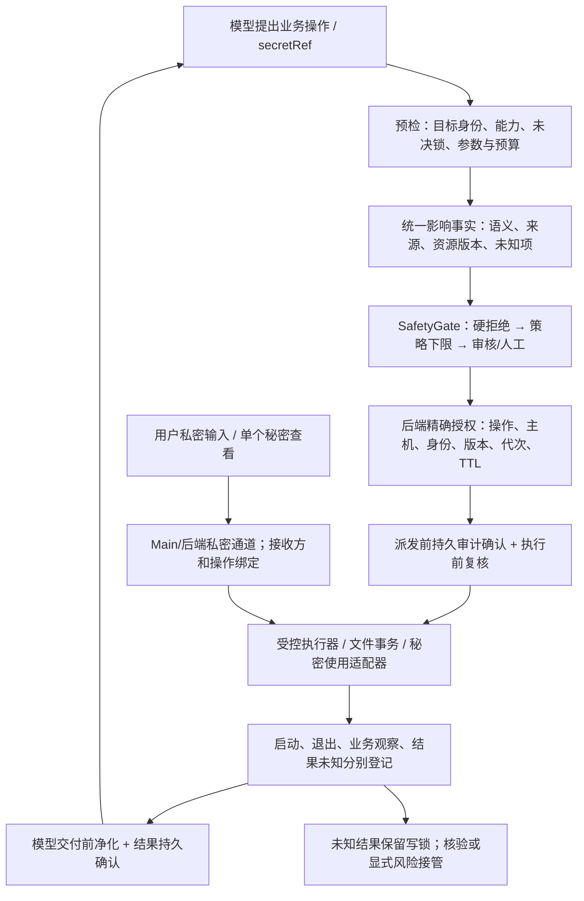

# 安全系统比较研究与改进建议

> 后续讨论已合并至[安全与自主执行统一设计](AGENT_SAFETY_AND_AUTONOMY_DESIGN.md)，包括独立诊断AI、软拦截纠正与硬熔断。本文保留比较过程、源码依据和历史验证；开发目标以统一文档为入口，当前行为仍以源码为准。

> 研究基准：`repair/comprehensive-audit`，HEAD `a50fae2`，CloudHelm 0.2.4。
> 对象：用户提供的《AI SSH 运维助手 · 安全模块完整架构文档》、当前源码、未完成整改账及已有研究。
> 本轮只研究、运行本地定向回归并新增本报告；不修改业务代码，不连接真实 SSH，不调用实际付费模型，不变更既有审核语义。
> 用户后续明确的目标：模式3由工具侧自主决定命令是否执行，不发起命令审批；允许就任务方向及必要细节澄清。该目标与当前源码行为不同，详见 §3.2；以下源码比较仍保留现状口径。

## 一、结论：保留现有工程底座，吸收新文档的产品化设计，不整体替换

**当前项目更适合作为落地底座；新文档更适合作为安全产品蓝图。二者取长补短，比任选一份重做更好。**

- 当前项目在**操作绑定认证、精确批准、执行前复核、取消/迟到结果隔离、未知结果写锁、文件事务和证据边界**上明显更细。这些不是文档的基础模块能直接替代的。
- 新文档在**执行权限与数据隐私正交、语义风险表达、密钥引用体验、临时授权、拒绝解释、审批疲劳与分阶段规划**上更系统。
- 新文档的**普通 PTY 输密码、为自动模式切换全局 sudo 缓存、Shell 文本替换注入秘密、只按命令 hash 缓存、绝对化“永不泄露”承诺**不宜照搬，部分会倒退现有安全边界。
- 当前项目也有重要缺口：**第三档自动允许不透明效果、任意应用秘密识别不完整、Linux 凭据存储后端未区分、稳定风险域与环境事实仍未收口、真实 SSH/崩溃/平台验收缺失**。

建议路线是：**先完成 A01、A05–A07、C03–C05、D01–D02、H03–H05 的安全闭环，再增加秘密能力与授权体验。不是先换 parser、换模型或增加更多命令黑名单。**

## 二、研究口径与证据边界

### 2.1 “未完成修改任务”指什么

本轮开始时 `git status --short` 仅有未跟踪的 `nul`，没有发现未提交业务 diff。因此这里的“未完成”主要指**整改账中的剩余工作**，不是猜测存在尚未提交的补丁。

以 [REPAIR_STATUS_OVERVIEW.md](REPAIR_STATUS_OVERVIEW.md) 为当前父项口径：42 项中，4 已完成、19 已实现待验收、10 进行中、9 待开始。待验收不等于完成；UI 的 U01–U12 不重复计入父项。

`STATUS.md` 等文档保留了较早阶段的完成记录；专项方案中也有已被后续提交改变的历史现状。**冲突时以 HEAD 源码、近期进度记录和明确的验收边界为准，不能拼接不同历史基线冒充当前全链通过。**

### 2.2 证据分级

- **源码确认**：本报告列出具体实现位置，可复核设计与当前行为。
- **本地回归**：只证明选定测试的断言，不等于真实 SSH、真实模型或生产验收。
- **设计建议**：尚未实现或验证，不作为现存漏洞利用的证明。
- **外部线索**：官方文档检索及已有固定提交源码研究；与实机行为分开。

原计划增加独立只读审查，但审查工具因 Pi 可执行包解析失败未能启动，**本报告不宣称完成多模型独立评审或达成专家共识**。网页正文抓取也因工具的 fake-IP/SSRF 地址检查失败；没有修改网络安全配置绕过。外部检索摘要不能替代完整原文核验，关键结论优先依赖本地代码与随依赖分发的 API 声明。

## 三、逐项比较：谁的方案更好

| 维度 | 新文档 | 当前项目 | 判断与建议 |
| --- | --- | --- | --- |
| 总体安全模型 | 四线正交，产品表达清晰 | 分层架构、安全门和后端权威较成熟 | 采用文档的表达，沿现有分层实施 |
| AST 与命令语义 | 思路正确，强调嵌套和上下文 | 已有 Tree-sitter WASM、Git/tar/包装上下文、受限查询管道 | 当前更具体，不换 parser，继续补语义覆盖 |
| 模式设计 | 模式1写入人工；模式3无人兜底 | 模式1普通写入可自动；模式3不透明可自动、高影响仍人工 | 语义不同，必须显式决策，不算普通重构 |
| 审核器隔离 | 独立会话、只升不降 | 独立无工具调用、显式审核源、故障不换计费路由 | 保留现有机制，补明确的权限上限 |
| 批准与执行 | 唯一入口、一次性 token | 绑定内容/主机/目录/身份/策略/终端/连接等并多次复核 | 当前更强；不要退化为普通 wrapper token |
| 密码输入 | 输出正则识别后写 PTY | 结构化 SSH 认证及 sudo askpass 私密通道 | 当前明显更好，文档这一段应重写 |
| sudo 缓存 | 推荐 global，甚至随模式临时切换 | 有任务/身份/连接/终端绑定的内存缓存 | 保留现有路线，不自动改 sudoers |
| SSH 连接复用 | OpenSSH ControlMaster | ssh2 持有连接并复用通道与连接代次 | 两种实现路线；无须为复用而迁移 |
| 服务秘密 | vault、被动检测共用映射表 | 主要是敏感路径拒读与模式脱敏 | 文档补足方向，但文本替换需改为受控秘密能力 |
| 输出脱敏 | 强调统一入口 | 已有跨块/跨行、ANSI、溢出与尾部处理 | 当前流处理更细；检测广度仍不足 |
| 文件安全修改 | 备份、trash、快照 | 后端 editId、版本/元数据、原子交换、显式恢复 | 当前更完整；仍有平台/竞争/清理验收缺口 |
| 未知结果与重放 | 主要强调循环检测 | 未决写锁、派发阶段、精确停止与恢复 | 当前明显更好，循环检测不能替换它 |
| 临时授权与可解释性 | TTL、语义模板、拒绝反馈 | 精确单次批准、具体原因码已部分落地 | 先强化展示，再谨慎引入有界授权 |
| 验收与迁移 | 分期方向合理 | 具体整改与故障注入已有，但真实链未完成 | 当前账更可操作，必须守住“待验收”口径 |

### 3.1 必须讲清楚的三档差异

源码依据：`packages/core/src/safety.ts:314–406`；回归入口：`Tests/core/safety-risk-matrix.test.ts`。

| 场景 | 当前第一档 | 当前第二档 | 当前第三档 | 新文档第三档 |
| --- | --- | --- | --- | --- |
| 已证明普通查询 | 自动 | 自动 | 自动 | 自动 |
| 有界普通写入，如字面 touch/cp | 可自动 | 可自动 | 可自动 | 文档表格要求写入经 LLM |
| 已识别高影响，如广泛删除、访问控制 | 人工 | 独立审核，可放行/转人工/拒绝 | 人工 | LLM 审核，无人工兜底 |
| 有效但效果不透明的命令/项目代码 | 人工 | 独立审核 | 可自动 | 审核不确定则拒绝 |
| 已识别硬禁令、受保护资源 | 拒绝 | 拒绝 | 拒绝 | 拒绝 |
| 解析失败 | 错误、不执行 | 错误、不执行 | 错误、不执行 | 文档主张失败关闭 |

因此不能笼统说“新第三档更安全”：**它对未知效果更严格，却可能把现有必须人工确认的高影响操作交给概率性审核器。** 当前第二档也并非“所有高影响都必须人工”，必须用完整矩阵比较。

**按用户后续要求修订：**模式3的产品目标确定为“自主执行、零命令审批、允许业务澄清”，不再把高影响操作逐次交给用户，也不要求用户先逐条预批。工具侧在既定任务范围和策略内决定执行、拒绝或阻塞；安全审核不确定时不转人工审批。当前第二档可继续作为工程验收对照，但不能用其人工兜底替代模式3的目标。变更需显式迁移，撤销旧授权并更新界面说明，不能把下述目标当成现已实现。关联 A06/A07/H04。

### 3.2 用户确认的模式3目标：自主决策，不是无条件放行

**职责边界：AI 提出方案和澄清业务需求；工具侧安全体系拥有最终执行决定权。** 工具侧可由解析器、确定性规则、独立审核器及执行前复核共同实现；是否每类操作都调用审核模型是内部策略，不改变“不得向用户申请命令批准”的语义。

| 情况 | 模式3目标行为 | 是否询问用户 |
| --- | --- | --- |
| 明确有界、策略允许的操作 | 工具自动授权并执行 | 不问 |
| 高影响但在任务范围内的操作 | 工具按策略及必要的独立审核自动决定；不能仅因高影响就弹审批 | 不问 |
| 硬禁令、保护资源、越出不可扩大的授权范围 | 拒绝，返回原因并让AI寻找合法替代方案 | 不问“是否破例” |
| 解析/审核失败、效果无法确定、安全组件不可用 | 拒绝本次执行或阻塞依赖步骤，说明原因；不得自动放行 | 不转人工审批 |
| 远端结果未知 | 先做获准的只读核验；无法解除则保持阻塞，不重放 | 不问“是否承担风险继续” |
| 业务目标、资源选择或必要参数确实缺失 | 允许AI提出具体业务澄清问题，回答后重新形成操作并走安全门 | 可以澄清 |

**澄清白名单示例**：“部署测试环境还是生产环境？”“使用哪个域名？”“日志保留多少天？”前提是任务确实缺少信息，不能重复追问已明确的内容。

**不能伪装为澄清**：“命令有风险，是否继续？”“允许执行这条删除命令吗？”“审核失败，是否跳过检查？”业务澄清回答只是任务输入，不是批准令牌，不能直接解除硬拒绝、未知结果写锁或授权失效；新的操作仍需工具独立判断。

模式3也不得因连续阻断、循环检测或审核故障自动降到需要人工批准的档位。可返回替代方案、结束无法完成的步骤或显示非交互阻塞状态；用户主动切换档位是另一条显式控制路径。

**认证边界单列，不混同澄清：**需要密码、验证码、未知主机指纹确认或解锁vault属于认证/信任交互，不属于业务澄清。本次要求不能被解释为允许把这些值交给模型或普通Shell。目标流程优先使用已建立的可信连接和有效私密凭据；无法无交互继续时保持阻塞并显示原因，不借澄清索密。若将来要在模式3保留专用认证弹窗，应另行明确例外，不能默认从“可以澄清”推出。

**验收新增硬断言：**模式3各命令路由（包括高影响、审核不确定/故障/超时、连续阻断及恢复）均不得调用命令审批接口或进入等待命令批准状态；业务澄清仍可正常投递，澄清回答不能充当执行授权。

用户进一步要求长任务自主完成、减少无说明中断；“操作拒绝/阻塞”不应一律变成“整轮中止”。其后端恢复、核验、检查点、异步澄清与宿主生命周期设计见[模式3运行连续性研究](AGENT_CONTINUITY_DESIGN_REVIEW.md)，仍不允许未知变更重放或借澄清绕过禁令。

## 四、新文档应先修正的安全问题

### 4.1 普通 PTY 的 Password 提示不是可信认证挑战

任意程序都能打印 `Password:`。关闭 echo 只影响终端回显，不能证明下一段输入由 sudo/mysql 接收；超时、进程退出、子进程切换还可能让迟到密码进入业务 stdin。清空缓冲也不能撤销已读取的数据。

应保留现有：

- SSH keyboard-interactive 使用结构化认证回调；
- sudo 使用操作专属 askpass/socket，不向业务 PTY 写密码；
- 请求绑定操作、接收方、身份、连接/终端代次、截止时间；
- 不认识的 PAM/mysql/GPG 等交互默认人工处理，逐种增加可信适配器，而不是统一正则索密。

证据：`packages/adapters/src/remote-command-program.ts:41–63,175–182`、`packages/adapters/src/ssh-command-terminal.ts:234–242`、[SECURITY.md](SECURITY.md)。这也直接符合 `AGENTS.md` 对密码不得进入普通 Shell 输入的约束。

### 4.2 不应因开启 AI 自动模式就修改 sudoers 为 global

审批模式解决“是否批准某个动作”；sudo 时间戳解决“系统是否再次认证”。二者不能互相替代。

`global` 会扩大同一用户其他登录会话可复用认证的范围，不是“这台主机上任意用户的任何进程”都直接获得 sudo；实际仍受用户身份、sudoers 和认证策略约束。但这依然是授权面扩大，不能作为默认优化，更不应由模式2/3触发临时配置写入。

当前 `SudoCredentialCache` 有五分钟 TTL，按任务/主机/登录与目标身份/终端及连接代次/策略绑定，失效会清零 Buffer。它也不是零风险：仍有进程内存驻留，转为 JS string 后不保证所有副本清零。建议明确此权衡，而不是宣称“即用即弃”同时又缓存。

证据：`packages/application/src/sudo-credential-cache.ts:3–33`。继续使用操作级认证；服务器自身缓存遵循管理员策略。

### 4.3 占位符不是安全边界，秘密的“使用权限”才是

`cmd.replace(placeholder, real_value)` 有三类问题：

1. **Shell 语法注入**：秘密中的引号、换行、`$()`、反引号可能改变最终程序。禁止单引号/heredoc并不能解决；占位符本来就是在 Shell 解析之前被应用替换，不能用“Shell 不展开它”判断安全性。
2. **数据外发**：模型虽然不知道真值，仍可构造把占位符发送给任意网络目的地的命令。隐藏值不等于限制它的用途。
3. **批准内容变化**：批准的是占位符模板，执行的是另一个载荷。秘密版本、目的地、接收程序或用途改变都应使授权失效。

建议新增有限的秘密使用端口，模型传 `secretRef`，后端按适配器使用私密管道/文件描述符或其他受支持机制。授权绑定：**主机、身份、任务、秘密版本、程序、用途、目的地、有效期和次数**。默认不向任意 Shell 注入；不支持就拒绝。

环境变量也不是普遍安全的兜底：它可能被同身份/高权限进程、子进程、诊断和崩溃数据读取。私钥尤其不应作为多行文本插进命令，更不能把 PEM 正文当作 `ssh -i` 的文件路径。

### 4.4 “严格隐私”的能力承诺必须真实

文档一方面允许宽松模式把配置密码发送给 LLM，另一方面称任何模式都“上下文永不出现密码”，自相矛盾。

建议拆成：

- **永不主动进入模型的认证材料**：SSH 登录秘密、交互式认证回答、本地模型 API Key（但模型 API Key 会按协议发送给用户选择的模型服务端）；
- **严格模式的应用秘密策略**：禁止读取指定秘密资源、受控识别与脱敏、秘密引用和用途限制；
- **用户显式披露应用数据**：单独确认、记录接收方与范围，不能再宣称该会话从未披露。

已披露内容不会因切回严格而撤回；可建议新建干净会话，但旧历史、摘要、日志及服务端留存也不会因此消失。

更根本的是：**允许任意远端程序读取秘密并任意输出/联网时，字符脱敏不能保证秘密永不泄露。** 任意程序都能重新编码、拆分或变换秘密，不限于 base64/xxd。高保密场景需要远端身份/文件/网络权限约束，或不授予通用读取能力；检测引擎只作为补充。

### 4.5 两处确定性规则应统一，不能 first-match-wins 误放行

- §1.2 允许全局关闭红线，与 §2.4/最终不变量的不可覆盖冲突。推荐硬禁令不可由普通规则关闭；用户人工终端是独立信任边界，不冒充 Agent 特批。
- §2.7 把用户规则含 allow 放在红线前，与不可覆盖冲突。推荐先验证系统不变量与硬拒绝，再按受信策略处理 deny/ask，allow 只能减少本来允许自动化的询问，不能覆盖硬禁令、凭据保护、未知写锁或人工确认下限。

所有匹配事实均保留供解释，不要因为找到 allow 就停止检查余下风险。

### 4.6 审核缓存不能只绑定命令，审批结果不应作为缓存复用

同一条命令在不同主机、cwd、身份、文件版本、prod/dev、策略版本或连接代次下，含义不同。`temperature=0` 也不等于确定性。

可缓存有界的静态分析或带版本/TTL的审核建议；**建议缓存不是执行许可**。每次执行仍重新验证当前状态。会话授权应是独立的后端能力，绑定精确模板与条件，取消、策略变化、接管、断线等可撤销。

保留现有 SHA-256 操作指纹绑定，不改为仅命令 hash 或 MD5。证据：`packages/core/src/fingerprint.ts:4–35`。

### 4.7 其他需要纠正的具体点

- **密钥 ID**：短明文 hash 对低熵密码可能帮助离线猜测，并泄露跨项目同值关系。改用后端随机不透明 ID，或带本地密钥的 HMAC；可在会话/授权域内稳定，不要求跨主机全局去重。类型标签按需公开，不泄露不必要路径。
- **UI 查看**：不让 renderer 持有整张真值映射表。Main 保管秘密，preload 只提供鉴权、限时、按单个引用读取的窄 IPC；审计只记访问事件。
- **在线验证**：trufflehog 等在线验证会访问外部服务、使用被发现凭据，不能默认后台开启；需要范围和出站授权。
- **扫描缓存**：路径+mtime 不够；至少结合主机身份/连接、文件版本与内容摘要、扫描器/规则版本。恢复旧缓存不能恢复旧权限。
- **低误报不等于可以停止检测**：`.lock`、构建产物、压缩文件也可能夹带秘密；可调整扫描策略或限额，不把扩展名直接当作可信豁免。
- **可解释审批**：应展示语义摘要，也保留原始命令或精确 diff 的按需展开；自然语言摘要不是完整载荷。拒绝理由可选，不应强制用户为安全拒绝额外打字。
- **分期**：基础净化、敏感路径保护、持久审计失败关闭和最小对抗回归必须从一期就有，不能为了 MVP 延到二期。

## 五、当前项目真正值得优先补的地方

### 5.1 第三档不透明放行：已确认的产品风险选择，而非新发现的绕过漏洞

`permissive` 会允许不透明脚本、项目代码、检测到的普通代码执行/外传以及其他有效未知命令；这不是解析失败放行，也不是覆盖已识别高影响或硬禁令。

用户已明确第三档要改为工具自主决策、零命令审批（§3.2）。因此需同时移除现有“高影响转人工”的模式3路由，并补上不透明操作的工具判定及失败关闭，不能只删除审批弹窗或把 ask 全部改成 allow。界面、等待状态、循环控制与 H04 迁移一并更新；生产发布门槛包含该完整矩阵，而不仅是测试通过。

### 5.2 密钥检测广度有限：当前不存在完整 vault + 可逆占位符体系

`packages/core/src/redaction.ts:3–24` 主要按字段名、Authorization、私钥块和部分 key 格式脱敏；流式实现有跨块/跨行与资源保护，但任意裸值、业务自定义格式和编码输出仍可能漏过。

`packages/core/src/sensitive-read.ts:6–18` 默认拒读 .env、常见私钥和若干凭据路径；任意应用秘密依赖用户保护路径。受控编辑遇到检测到的秘密会拒绝交付或编辑，而不是已经支持秘密保留的无损编辑。

建议两步走：

1. 建立覆盖所有模型出站通道的清单：主会话、审核器、摘要/压缩、引用、本地资料、错误、结构化结果与恢复历史；统一数据来源和净化策略。先补已知值匹配与更多结构化格式，但不承诺任意秘密识别。
2. 再建立后端秘密引用服务与私密文件编辑字段。检测库放在 adapters，纯策略留 core，端口由 application 使用，UI只投影。

结构化读取已有“读取前持久审计确认、交付前结果审计确认、动态撤权丢弃正文”，应复用而不是替换成一个可能已晚于 SDK 持久化的 PostToolUse hook。证据：`apps/desktop/src/worker/audited-remote-read.ts:19–80`。

### 5.3 Linux safeStorage 后端校验是一个具体可修的缺口

`apps/desktop/src/main/credential-storage.ts:19–34` 仅检查 `isEncryptionAvailable()`，未区分 Linux 后端。本地随 Electron 依赖分发的 `electron.d.ts:12110–12126` 明确提供 `basic_text`、`unknown` 等后端和 `getSelectedStorageBackend()`。

建议 Linux 保存秘密前确认合适的 OS secret-store 后端；`basic_text` 或无法确认的后端不冒充安全 keyring，拒绝持久保存或明确提供仅内存路径。保留“凭据不可用仍可启动并修复设置”的 F01 设计。

这是**源码确认的防护缺口**，不是本轮已复现用户 Linux 主机发生明文泄露；当前 Windows 的合成加密回归不能覆盖它。Electron safeStorage 是加密 API，也不等于独立 vault 或隔离同用户恶意进程。

### 5.4 稳定目标风险域与执行环境必须先收口

- A01 已用持久配置谱系保留未决锁，但独立重复配置、无谱系别名仍可能表示同一真实目标，不能只凭换配置 ID 就当新风险域。
- 也不能仅凭 IP、DNS 或主机指纹自动合并：NAT、容器、多身份及克隆主机存在歧义。需要明确的后端目标登记、用户确认的关联及失效规则。
- D01/D02 仍待开始：SSH 已连通、Python 存在、metadata ready、当前身份能执行某程序是不同事实；PATH、cwd、身份、架构/ABI及能力刷新需要与实际执行一致。

这比服务器标签简单“风险加一级”更重要。证据：`packages/core/src/host-risk-domain.ts:1–54`、[REPAIR_STATUS_OVERVIEW.md](REPAIR_STATUS_OVERVIEW.md)。

### 5.5 文件事务方向正确，下一步是安全验收与可用性，不是再加 cp 备份

现有 `FileEditService` 有一次性 editId、十分钟 TTL、四份/8 MiB预算、完整差异与版本绑定；驱动有逐层 O_NOFOLLOW、普通单链接文件、元数据读回、原子交换、fsync、恢复收据与新审核。

需要继续补：

- 真实 ext/XFS、ACL/xattr、SELinux/LSM、sudo/PAM、断线和 utility process 崩溃；
- 原子交换前后竞争：rename 不是跨进程 CAS，不能承诺任何外部并发都安全；
- 恢复目录的归属、容量、保留期、安全清理与不可删除的未决恢复材料；
- 候选配置如能在正确路径/包含文件语义下安全校验，优先提交前检查；提交后复查失败不能自动宣称业务恢复；
- 驱动目前要求 UID0/CAP_SYS_ADMIN 等条件才能声明完整元数据支持，保守但影响适用面。先实测，再考虑显式有限元数据配置或专用受限 helper；不能为成功率静默丢弃属性、开放通用 root Shell或给 Agent 常驻大权限。

证据：`apps/desktop/src/worker/file-edit-service.ts:16–171`、`packages/adapters/src/remote-file-program.ts:70–205`。关联 C03/C05/H03。

### 5.6 审计不只是“事后可见”，还应是派发前的必要条件

现有 SafetyGate 在 proposed/decided 持久确认后才执行，读取也有交付门槛，比“命令跑完再记日志”更强，应保留。

仍需区分：审计不可写导致“未派发”；与远端已启动后结果审计失败导致“可能执行、待核验”。SQLite 不能保证本地管理员不可篡改；如有企业需求，再加有锚点的哈希链/签名导出或远端只追加存储。仅本地哈希链不能阻止有权限者整体重写。

证据：`packages/application/src/safety-gate.ts:49,204–218`。未决操作写锁不因模型报告或普通“继续”消失，证据：`packages/application/src/host-serial-executor.ts:4–32,140–178`。

### 5.7 防循环与预算：保留已有强保护，再补体验指标

已有 replay/AI 拒绝记录/未知写锁与请求次数预留，不能被新文档的“20项窗口、3/4次阈值”取代。重复查询可能是合法观察；相同命令未知后一次重放就可能危险，不能等第三次才拦。

循环检测可辅助发现没有进展的重新规划，但应纳入操作类型、效果、最新观察和拒绝原因。重复“未知变更”由后端立即阻断，普通诊断由上下文判断。连续弹窗可以触发建议、暂停或重新规划，不能盲目切到一个名称叫“手动”但仍允许普通写入的档位。

H05 已有次数预算基础，不等于实际费用、输出/输入规模和总时长硬上限已经完成；主模型、审核、摘要、重试应统一计入可解释的硬限制。先完成 H05 再做实际付费模型行为评估。

证据：`apps/desktop/src/worker/task-operation-preflight.ts:27–53`、`packages/core/src/request-budget.ts`。

## 六、建议的目标架构与安全不变量

建议统一成七条可测试的不变量：

1. 认证回答、SSH连接秘密不进入模型和普通 Shell stdin；本地模型凭据不进入对话，只送往用户明确配置的认证目标。
2. 所有 Agent 远端变更经过同一个授权体系，包括文件/服务/恢复/间接执行；后台固定辅助动作有明确权限和审计契约。
3. 硬禁令、保护资源和策略下限不能被模型、项目规则或旧缓存覆盖；模式1/2按各自规则处理人工确认，模式3不得发起命令审批，无法自动获得合法授权时拒绝或阻塞。
4. 批准绑定最终操作及依赖资源版本；身份、策略、秘密版本、连接/终端或内容变化后失效。
5. 不能证明未执行/无影响的失败保持 unknown/possible；不自动重放、换身份或回滚。
6. 严格数据策略在模型交付及其持久化前生效；已披露事实不可追溯撤回，不对通用 SSH 承诺任意秘密零泄露。
7. 安全组件、审计确认、租约或协议失败不放行；执行前失败与执行后未知分别处理。

## 七、与现有未完成任务合并的实施次序

以下优先级表示建议，不修改原父项状态，也不把已有“待验收”重新算成新漏洞。

| 顺序 | 工作包 | 对应账项 | 交付/验收底线 |
| --- | --- | --- | --- |
| P0-1 | 固定审核矩阵与威胁模型，实施第三档零命令审批迁移 | A05–A07/H01/H04 | 模式3工具自主判定，失败拒绝/阻塞不转人工；业务澄清不授予权限；策略改变撤销旧批准；兼容迁移可回退但不恢复失效权限 |
| P0-2 | 补稳定风险域与环境身份一致性 | A01/D01/D02 | 换配置不丢未知锁；同目标关联不靠不可靠猜测；探测与执行上下文一致 |
| P0-3 | Linux凭据后端检查和全模型出站通道盘点 | A04/F01/H01/H02 的补充子包 | basic_text等不冒充安全保存；主/审核/摘要/引用/错误/恢复路径均有数据契约 |
| P0-4 | 收口文件事务、恢复与崩溃链 | C03–C05/H03 | 不支持元数据时拒绝；提交后断线保持未知；恢复新审核；私有材料有生命周期 |
| P0-5 | 完成预算门槛并开展真实隔离验收 | H03/H05 | 先独立确认指纹、设置成本硬限额；三条真实业务链，覆盖 sudo/PAM/断线/崩溃 |
| P1-1 | 受控秘密引用与用途限制 | A04/C03/C05/H01 下新增明确子包，必要时单独立项 | 不做通用Shell文本注入；跨主机/目的地/身份/版本/用途不可复用；秘密编辑不靠脱敏文件重建 |
| P1-2 | 精确临时授权与审批展示 | A06/A07/F05/U06/H04 | 先展示语义+原文/diff、理由和状态；授权TTL、次数、撤销、命中解释；不自动生成任意通配模板 |
| P1-3 | 语义回归、外传/持久化和间接执行 | A05/H02 | Git钩子、包脚本、SSH/docker/kubectl上下文、cron和shell启动文件；未知保持未知 |
| P2 | prod/dev策略、可选远端约束、企业秘密服务 | H01/H04及明确新增项 | 标签来源可信；项目配置不能放宽强制底线；可选专用账户/服务隔离/网络限制按能力声明 |

不要把系统级 sudoers 改写、默认在线验密、通用 root Shell或自动回滚作为“提升体验”的捷径。也无需为这轮路线重新引入 Tauri、node-pty 或 ControlMaster：当前 Electron + ssh2 + 受控执行器已经具备所需装配基础。

## 八、如何判断下一版确实变好

### 8.1 最小对抗与故障矩阵

- 命令变形：分割引号、绝对路径、包装器、替换、目录变化、Git全局参数、输入/输出重定向、脚本在批准前后变化。
- 组合效果：单看安全的“读取 + 联网”、包管理钩子、容器挂载、持久化计划；**风险不能只取子命令最大值，还要分析组合后的新增能力**。
- 秘密：任意分块、跨行PEM、无换行尾部、ANSI、长行、裸值、结构化结果、编码变换、审核/摘要/恢复历史与秘密版本更换。
- 认证：伪造Password输出、挑战取消/超时、重复/迟到回答、业务进程结束后回答、身份切换和人工接管。
- 授权：TTL边界、过期卡、策略/模型/主机/连接/终端变化、重复消费、项目规则不可提权。
- 文件：符号链接、硬链接、并发改写、ACL/xattr/特殊属性、原子交换前后断线、结果收据丢失、恢复源变化和清理失败。
- 结果：业务未启动、已启动但无结果、退出非零但只读、部分变更、后台存活、停止信号已送达但未退出。
- 实机：普通诊断；配置读取→diff→受控提交→语法检查→服务动作→业务观察；后台启动→观察→精确停止。

### 8.2 衡量指标

优先记录：硬拒绝/未决锁误放行数、敏感测试值到达出站请求/本地历史的次数、迟到批准/认证被消费次数、未知结果错误重放数；这些应为零。其次记录正常诊断误询问率、审批次数、无效工具选择、恢复耗时、审核延迟和费用。

不以“LLM说安全”作为真值，也不以“弹窗变少”单独证明安全提升。训练审核器或收集审批样本需要数据最小化、去标识、明确同意；用户允许某次行为不是普遍安全标签。

## 九、本轮验证与局限

- 已读：当前核心策略、SafetyGate、影响事实、AST与上下文、独立审核器、认证私密通道、脱敏、读取审计、凭据存储、文件事务、风险域、串行执行及整改进度。
- 定向回归：后台任务 `b75aa15e4` 退出码 0，5 个文件、68 项测试全部通过：`Tests/core/safety-risk-matrix.test.ts`（37）、`Tests/application/safety-risk-matrix.test.ts`（3）、`Tests/application/safety-review-cancellation.test.ts`（10）、`Tests/core/redaction.test.ts`（6）、`Tests/desktop/main/credential-isolation.test.ts`（12）。命令为 `pnpm exec vitest run` 加上述五个路径及 `--maxWorkers=2 --minWorkers=1`。这些是本地策略、审核取消、基础脱敏及合成凭据隔离测试；本轮没有运行专门的任意分块流式回归或真实 OS keyring 验收。
- 报告的 5 个不同本地 Markdown 链接均可读取，`git diff --check` 退出 0（报告为新增未跟踪文件，该命令不覆盖其未暂存正文）。未运行全量/构建/真实桌面/SSH或模型验收。
- 未做：完整渗透测试、任意编码程序数据流证明、实际 Linux keyring/SELinux/PAM/ACL竞态验证、安装包/跨平台测试、真实模型审核准确率或费用评估。
- 不将源码可疑点表述为已发生生产泄露，不将单元测试通过表述为系统安全证明。

## 十、外部资料与已有研究

1. Electron safeStorage 官方 API：<https://www.electronjs.org/docs/latest/api/safe-storage>。本轮检索支持需区分 Linux backend；原文抓取失败。后端枚举另由当前本地依赖 `apps/desktop/node_modules/electron/electron.d.ts` 核对，不能据当前网站新API推断项目固定版本必须升级。
2. sudoers 手册：<https://manpages.debian.org/trixie/sudo/sudoers.5.en.html>。本轮检索核对 global/tty 范围；目标主机真实配置仍需实测。
3. OpenSSH 配置手册：<https://man.openbsd.org/ssh_config>。ControlMaster是实现连接复用的一条路线，不是 ssh2 的必要补丁。
4. Claude Code permissions：<https://code.claude.com/docs/en/permissions>。当前检索不足以确认用户文档中“bypassPermissions仍对所列rm路径强制提示”等具体承诺，**不采用该说法作为安全设计依据**；具体模式、产品界面和版本不可混为一谈。
5. 项目已有固定提交源码研究：[OPEN_SOURCE_COMMAND_SAFETY_SOURCE_REVIEW.md](OPEN_SOURCE_COMMAND_SAFETY_SOURCE_REVIEW.md)。cc-safety-net适合借鉴语义模块/测试；sh-guard可参考风险结构；均不直接替代远端授权体系，也不能使用本地路径事实代替远端事实。本轮未重新克隆或执行这些第三方项目。
6. 当前产品边界：[SECURITY.md](SECURITY.md)、[CONTROLLED_FILE_EDITS.md](CONTROLLED_FILE_EDITS.md)、[SECURITY_RUNTIME_ACCEPTANCE.md](SECURITY_RUNTIME_ACCEPTANCE.md)。

**最终建议：以现有 SafetyGate、私密认证和未知结果治理为根，以新文档的正交产品模型为外壳，补受控秘密能力与真实验收；不把概率审核、字符脱敏或用户点“允许”误当成远端隔离。**
